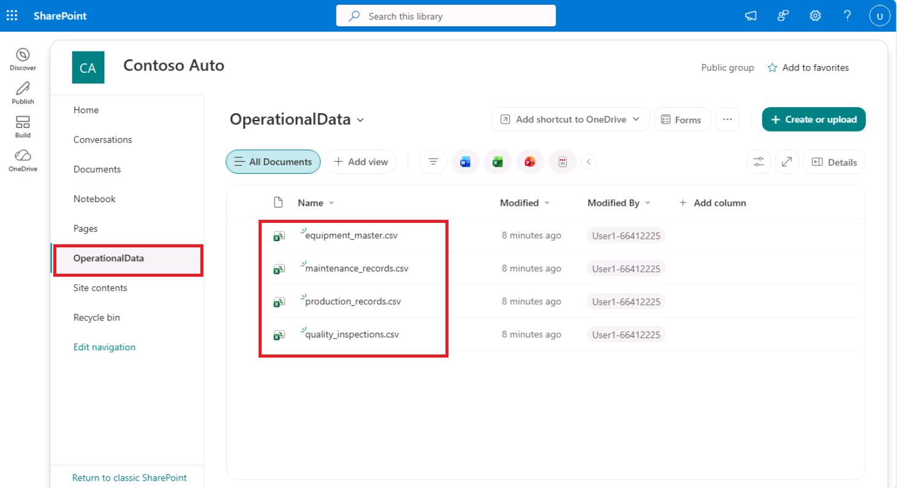
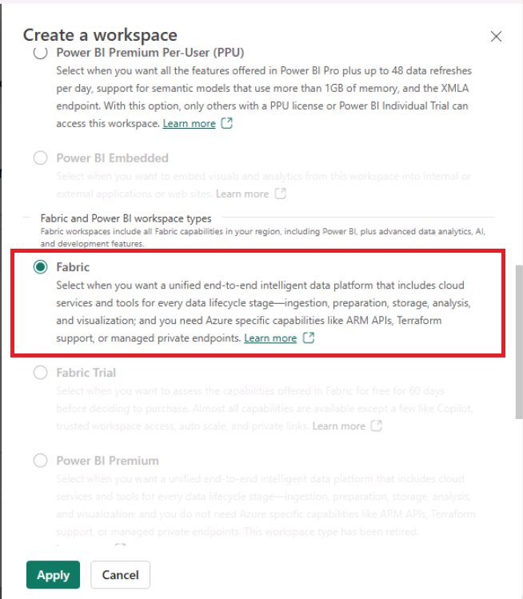
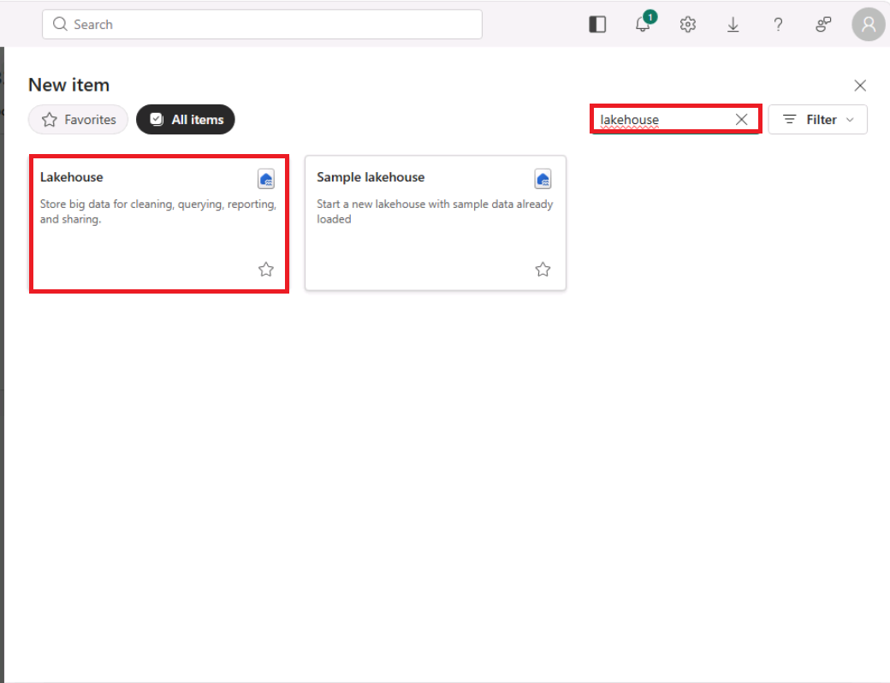
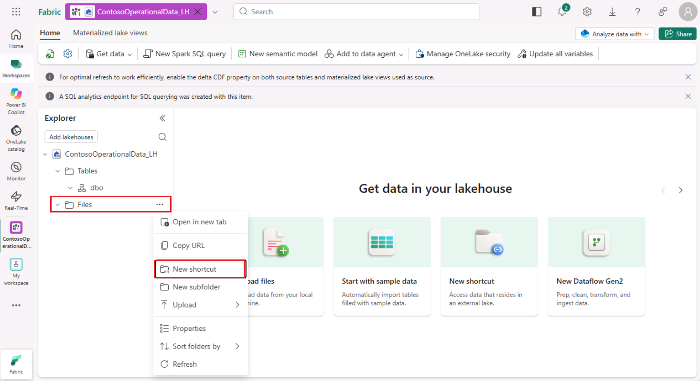
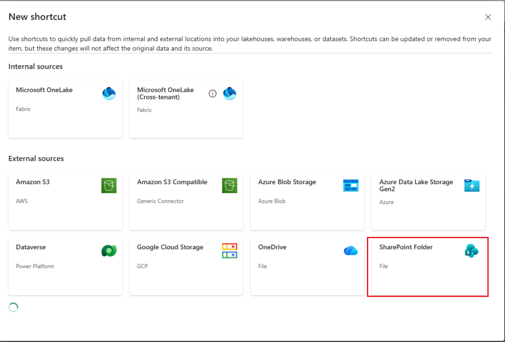
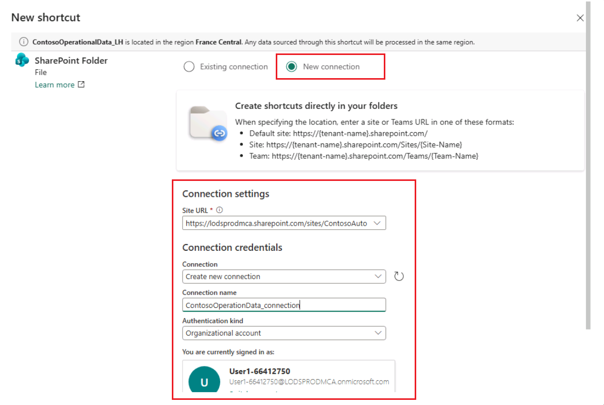
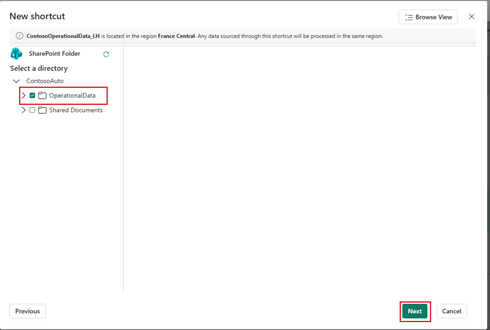
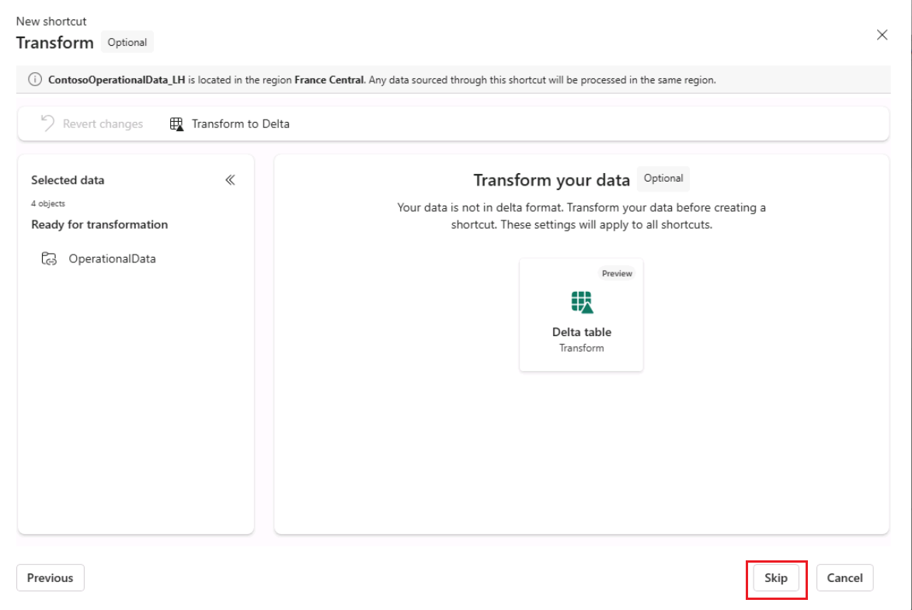
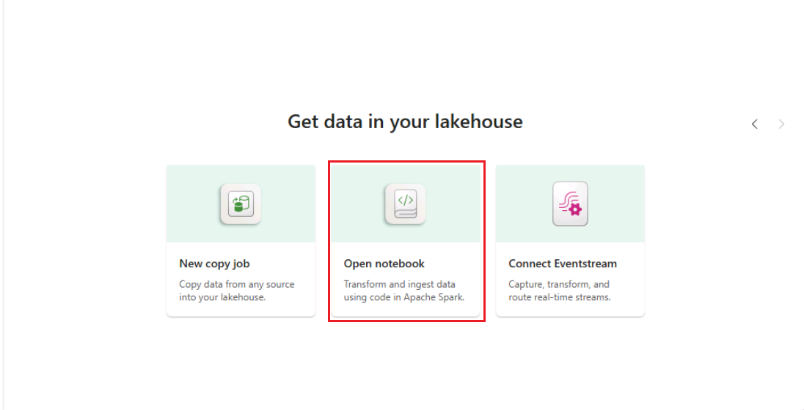

# Ingest Operational Data from SharePoint into OneLake

In this part of the lab, you will learn how to ingest operational data from SharePoint into OneLake by assisting **Contoso Automotive** bring their operational data into a centralized data lake for better analysis and reporting.

## Task 1: Explore SharePoint Data

1. In the lab environment, open **Microsoft Edge** and navigate to this **SharePoint site** using this link: `https://lodsprodmca.sharepoint.com/sites/ContosoAuto`

1. When prompted, sign in with the following credentials:
   - **Username:** `@lab.CloudPortalCredential(User1).Username`
   - **Tap:** `@lab.CloudPortalCredential(User1).TAP!`

    

1. On the left hand navigation pane, select the **OperationalData** library to explore the operational data available for ingestion into OneLake.

1. There should be 4 files in the **OperationalData** library representing different operational data sets.

    

---

## Task 2: Ingest Data into OneLake

1. In the lab environment, open a new tab in **Microsoft Edge** and navigate to the **Microsoft Fabric** portal using this link: `https://app.fabric.microsoft.com/`.

1. You should be already signed in but if prompted, sign in with the same credentials used for SharePoint.

1. In **Fabric**, select the **Workspaces** option from the left-hand navigation pane and then select **+ New Workspace** button.

    

1. Enter a name for the new workspace, such as `ContosoOperationalData_@lab.LabInstanceIdId`. Scroll to the bottom of the pane and ensure a fabric capacity is selected under the **Advanced** section then select **Apply**.

    

1. Inside the newly created workspace, select the **+ New Item** button. On the pop-up menu, search for and select **`Lakehouse`**.

    

1. Enter a name for the new lakehouse, such as `ContosoOperationalData_LH` and then select the **Create** button.

1. Under the **Explorer** pane of the lakehouse, select the **...** (ellipsis) next to the **Files** folder and then select **New shortcut**.

    

1. In the **New shortcut** pane, look for and select the **SharePoint Folder** option.

    

1. In the **SharePoint Folder** pane, select **New connection** and configure the following settings:
   - **SharePoint site URL:** `https://lodsprodmca.sharepoint.com/sites/ContosoAuto`
   - **Connection:** Select **New connection**
   - **Connection name:** Enter `ContosoOperationalData_Connection`
   - **Authentication method:** `Organizational account`
   - **Username:** `@lab.CloudPortalCredential(User1).Username`
   - **Tap:** `@lab.CloudPortalCredential(User1).TAP!`

    

1. Select **Next** to proceed with the connection setup.

1. Under the **Select a directory** section, select the **Operational Data** folder by checking the corresponding checkbox. Then select **Next**.

    

1. In the **Transform** dialog, select the **Skip** button.

    

1. Select the **Create** button.

1. The SharePoint folder should now be available as a shortcut under the **Files** folder in your lakehouse. You can expand the shortcut to view the ingested operational data files.

---

## Task 3: Clean and Transform Data

### Task 3.1: Load Operational Data from SharePoint

1. In the lakehouse, close the **Files** folder then under the **Get data in your lakehouse** screen select the **>** arrow and then select **Open notebook**. Choose **New notebook** from the options presented and select **Open**.

    

1. Load the **.csv** files from SharePoint into their respective dataframes in the notebook using the following code:

    ```python
    from pyspark.sql import functions as F
    from pyspark.sql.types import *
    # Use the correct base path for the default Lakehouse Files container.
    # In Fabric Spark notebooks, relative paths like "Files/..." always point
    # to the Files folder of the attached default Lakehouse.
    base_path = "Files/Operational Data"

    # (Optional) Quickly verify that the files exist at the expected location
    # before reading them as CSV.
    print("Listing files under:", base_path)
    for f in notebookutils.fs.ls(base_path):
    print(f.path)

    # Read equipment master data
    equipment_raw = (
        spark.read
        .option("header", True)
        .option("inferSchema", True)
        .csv(f"{base_path}/equipment_master.csv")
    )

    # Read maintenance records
    maintenance_raw = (
        spark.read
        .option("header", True)
        .option("inferSchema", True)
        .csv(f"{base_path}/maintenance_records.csv")
    )

    # Read production records
    production_raw = (
        spark.read
        .option("header", True)
        .option("inferSchema", True)
        .csv(f"{base_path}/production_records.csv")
    )

    # Read quality inspections
    quality_raw = (
        spark.read
        .option("header", True)
        .option("inferSchema", True)
        .csv(f"{base_path}/quality_inspections.csv")
    )
    
    ```

1. Explore the loaded data. In a new code cell, use the `display` function to view the contents of the `equipment_raw` dataframe:

    ```python
    display(equipment_raw)
    ```

1. Take a look at the schema of the `equipment_raw` dataframe to understand its structure. In a new code cell, use the `printSchema` method:

    ```python
    equipment_raw.printSchema()
    ```

1. Add a new code cell and run the following python code:

    ```python
        equipment_raw.select(
        "Plant",
        "ProductionLine",
        "EquipmentType",
        "Criticality"
    ).distinct().show(truncate=False)
    ```

1. Do you notice any patterns or anomalies in the distinct combinations of plant, production line, equipment type, and criticality?

1. Let's look at some of these anomalies in a new code cell.

    ```python
        equipment_raw.groupBy("Plant").count().show()
    ```

1. Notice how the **Durban** plant is being counted multiple times under different names instead of being consolidated under a single name. This indicates inconsistencies in the naming of the plant in the dataset.

1. Add a new code cell and run the following python code to check for missing values in the **maintenance_raw** dataframe:

    ```python
        maintenance_raw.select([
        F.sum(F.col(c).isNull().cast("int")).alias(c)
        for c in maintenance_raw.columns
    ]).show()
    ```

1. Notice that operational data created by different systems and teams isn't always perfectly standardized. Before using this data for analytics or AI, we'll create a consistent representation.

### Task 3.2: Standardize Maintenance and Equipment Data

1. Add a new code cell and start standardizing values in the `equipment_raw` dataframe, such as consolidating different names for the same plant. For example, you can create a mapping dictionary and use the `withColumn` method to apply it:

    ```python
        equipment = (
        equipment_raw
    
        # Remove unwanted whitespace
        .withColumn(
            "EquipmentID",
            F.trim(F.col("EquipmentID"))
        )
    
        # Standardize plant names
        .withColumn(
            "Plant",
            F.when(
                F.lower(F.trim(F.col("Plant"))).isin(
                    "dbn",
                    "durban plant",
                    "durban"
                ),
                "Durban"
            ).otherwise(F.trim(F.col("Plant")))
        )
    
        # Standardize production-line names
        .withColumn(
            "ProductionLine",
            F.initcap(F.trim(F.col("ProductionLine")))
        )
    
        # Standardize categories
        .withColumn(
            "EquipmentType",
            F.initcap(F.trim(F.col("EquipmentType")))
        )
    
        .withColumn(
            "Criticality",
            F.initcap(F.trim(F.col("Criticality")))
        )
    
        # Remove duplicate equipment
        .dropDuplicates(["EquipmentID"])
    )

    ```

1. Next, normalize the date by ensuring that there are no missing or inconsistent date values in the `equipment` dataframe. Add a new code cell and run the following python code:

    ```python
        equipment = equipment.withColumn(
        "InstallDate",
        F.coalesce(
            F.to_date("InstallDate", "yyyy-MM-dd"),
            F.to_date("InstallDate", "yyyy/MM/dd"),
            F.to_date("InstallDate", "dd-MM-yyyy")
        )
    )
    ```

1. Review the standardized **equipment** dataframe to ensure that all values are consistent and correctly formatted. Add a new code cell and run the following python code:

    ```python
        display(equipment)
    ```

1. Notice that the **InstallDate** column is now consistently formatted and any missing or inconsistent date values have been handled.

1. Next, clean the maintenance records in the `maintenance_raw` dataframe by standardizing date formats and removing duplicates. Add a new code cell and run the following python code:

    ```python
        maintenance = (
        maintenance_raw
    
        .withColumn(
            "EquipmentID",
            F.trim(F.col("EquipmentID"))
        )
    
        .withColumn(
            "MaintenanceType",
            F.initcap(F.trim(F.col("MaintenanceType")))
        )
    
        .withColumn(
            "IssueCategory",
            F.initcap(F.trim(F.col("IssueCategory")))
        )
    
        .withColumn(
            "MaintenanceDate",
            F.coalesce(
                F.to_date("MaintenanceDate", "yyyy-MM-dd"),
                F.to_date("MaintenanceDate", "MM/dd/yyyy")
            )
        )
    
        .withColumn(
            "DowntimeMinutes",
            F.col("DowntimeMinutes").cast("int")
        )
    
        .withColumn(
            "RepairCost",
            F.col("RepairCost").cast("double")
        )
    
        .dropDuplicates(["MaintenanceID"])
    )
    ```

1. Notice how you did not fill every **null** value in the **RepairCost** column. A missing **RepairCost** in this case does not necessarily mean that the value that will stored is zero; it simply indicates that the repair cost was not recorded.

1. Now, enrich the maintenance records by joining the cleaned `maintenance` dataframe with the standardized `equipment` dataframe to include equipment details. Add a new code cell and run the following python code:

    ```python
        maintenance_enriched = (
        maintenance.alias("m")
        .join(
            equipment.select(
                "EquipmentID",
                "EquipmentName",
                "EquipmentType",
                "Plant",
                "ProductionLine",
                "Criticality"
            ).alias("e"),
            on="EquipmentID",
            how="left"
        )
        )
    ```

1. Review the enriched maintenance records to ensure that the join was successful and all relevant equipment details are included. Add a new code cell and run the following python code:

    ```python
        display(maintenance_enriched)
    ```

### Task 3.3: Clean and Standardize Production and Quality Data

1. Begin by cleaning the production data in the `production_raw` dataframe by standardizing date formats and removing duplicates. Add a new code cell and run the following python code:

    ```python
        production = (
        production_raw
    
        .withColumn(
            "Plant",
            F.when(
                F.lower(F.trim("Plant")).isin(
                    "dbn",
                    "durban plant",
                    "durban"
                ),
                "Durban"
            ).otherwise(F.trim("Plant"))
        )
    
        .withColumn(
            "ProductionLine",
            F.initcap(F.trim("ProductionLine"))
        )
    
        .withColumn(
            "Shift",
            F.initcap(F.trim("Shift"))
        )
    
        .withColumn(
            "ProductionDate",
            F.coalesce(
                F.to_date("ProductionDate", "yyyy-MM-dd"),
                F.to_date("ProductionDate", "MM/dd/yyyy")
            )
        )
    
        .withColumn(
            "TargetUnits",
            F.col("TargetUnits").cast("int")
        )
    
        .withColumn(
            "ActualUnits",
            F.col("ActualUnits").cast("int")
        )
    
        .withColumn(
            "RejectedUnits",
            F.col("RejectedUnits").cast("int")
        )
    
        .withColumn(
            "DowntimeMinutes",
            F.col("DowntimeMinutes").cast("int")
        )
    
        .dropDuplicates(["ProductionRecordID"])
    )
    ```

1. Next, you can create a useful metric for Contoso's production efficiency by calculating the productionEfficiency as the ratio of actual units produced to target units. Add a new code cell and run the following python code:

    ```python
        production = production.withColumn(
        "ProductionEfficiency",
        F.round(
            F.col("ActualUnits") / F.col("TargetUnits") * 100,
            2
        )
    )
    ```

1. You can review the result using a display function. Add a new code cell and run the following python code:

    ```python
        display(production)
    ```

1. Now that you have cleaned and enriched the production data, you can proceed to clean and standardize the quality data in the `quality_raw` dataframe. Add a new code cell and run the following python code:

    ```python
        quality = (
        quality_raw
    
        .withColumn(
            "EquipmentID",
            F.trim(F.col("EquipmentID"))
        )
    
        .withColumn(
            "Plant",
            F.when(
                F.lower(F.trim("Plant")).isin(
                    "dbn",
                    "durban plant",
                    "durban"
                ),
                "Durban"
            ).otherwise(F.trim("Plant"))
        )
    
        .withColumn(
            "ProductionLine",
            F.initcap(F.trim("ProductionLine"))
        )
    
        .withColumn(
            "Severity",
            F.initcap(F.trim("Severity"))
        )
    
        .withColumn(
            "InspectionDate",
            F.coalesce(
                F.to_date("InspectionDate", "yyyy-MM-dd"),
                F.to_date("InspectionDate", "MM/dd/yyyy")
            )
        )
    
        .withColumn(
            "UnitsInspected",
            F.col("UnitsInspected").cast("int")
        )
    
        .withColumn(
            "DefectCount",
            F.col("DefectCount").cast("int")
        )
    
        .dropDuplicates(["InspectionID"])
    )
   ```

1. Similar to the production data, you need to introduce a quality metric. Here, you will calculate the defect rate as the ratio of defect count to units inspected. Add a new code cell and run the following python code:

    ```python
        quality = quality.withColumn(
        "DefectRate",
        F.when(
            F.col("UnitsInspected") > 0,
            F.round(
                F.col("DefectCount") /
                F.col("UnitsInspected") * 100,
                2
            )
        )
    )
    ```

1. Next, enrich the quality data by joining it with the equipment data from the **equipment** dataframe. Add a new code cell and run the following python code:

    ```python
        quality_enriched = (
        quality.alias("q")
        .join(
            equipment.select(
                "EquipmentID",
                "EquipmentName",
                "EquipmentType",
                "Criticality"
            ).alias("e"),
            on="EquipmentID",
            how="left"
        )
    )
    ```

1. Add a new code cell and run the following code

    ```python
        display(
        maintenance_enriched
        .groupBy(
            "EquipmentID",
            "EquipmentName",
            "ProductionLine"
        )
        .agg(
            F.count("*").alias("MaintenanceEvents"),
            F.sum("DowntimeMinutes").alias("TotalDowntimeMinutes"),
            F.sum("RepairCost").alias("TotalRepairCost")
        )
        .orderBy(
            F.desc("TotalDowntimeMinutes")
        )
    )
    ```

1. Finally, now that you have transformed and enriched the data you need to create delta tables that can be used for further analysis. Add a new code cell and run the following python code:

    ```python
    equipment.write.format("delta").mode("overwrite").saveAsTable("dim_equipment")

    maintenance_enriched.write.format("delta").mode("overwrite").saveAsTable("fact_maintenance")

    production.write.format("delta").mode("overwrite").saveAsTable("fact_production")

    quality_enriched.write.format("delta").mode("overwrite").saveAsTable("fact_quality")
    ```

1. You have successfully ingested, transformed, and enriched the operational data from SharePoint and ended up with dimensional and fact tables in Delta format.

## Next Steps

> Select **Next >** to proceed to bring data from Iceberg.