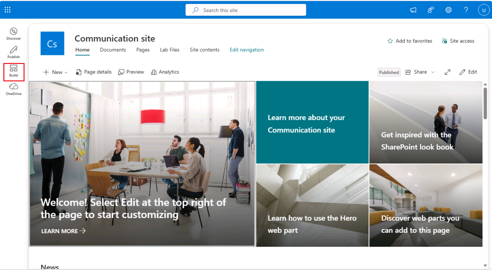
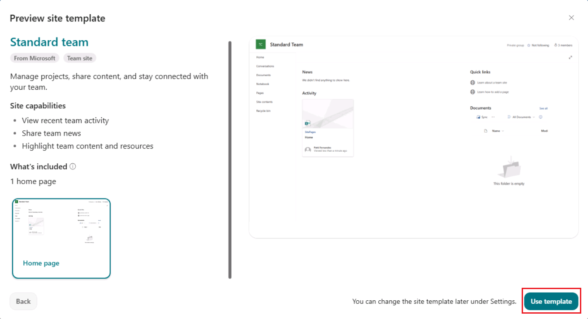
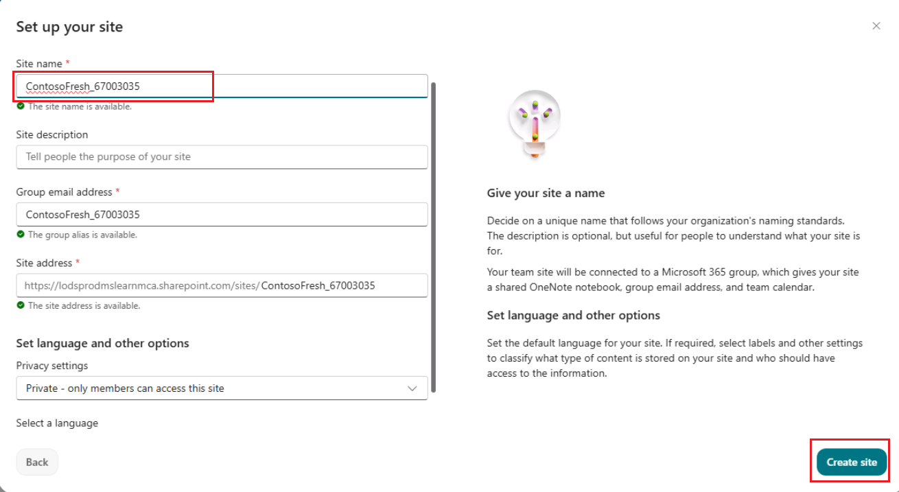
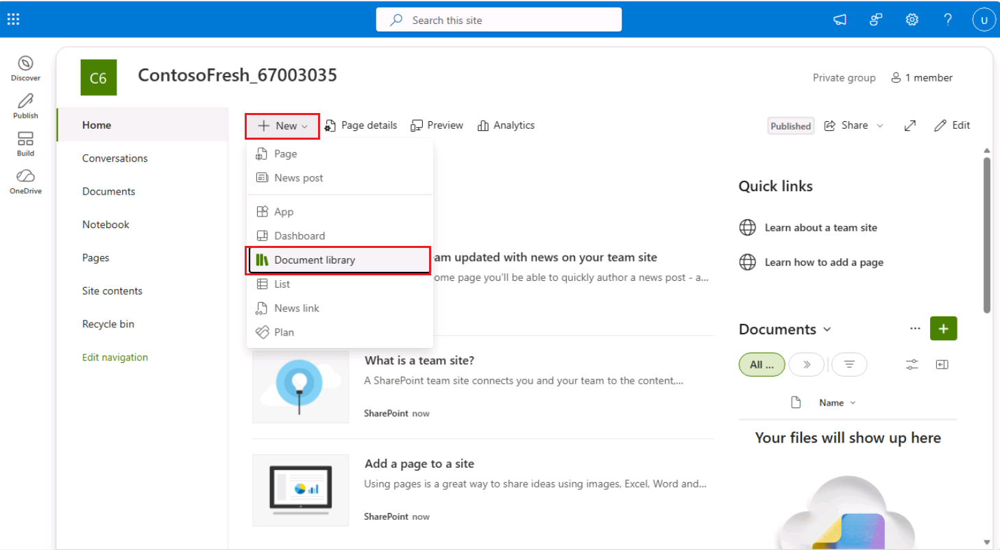
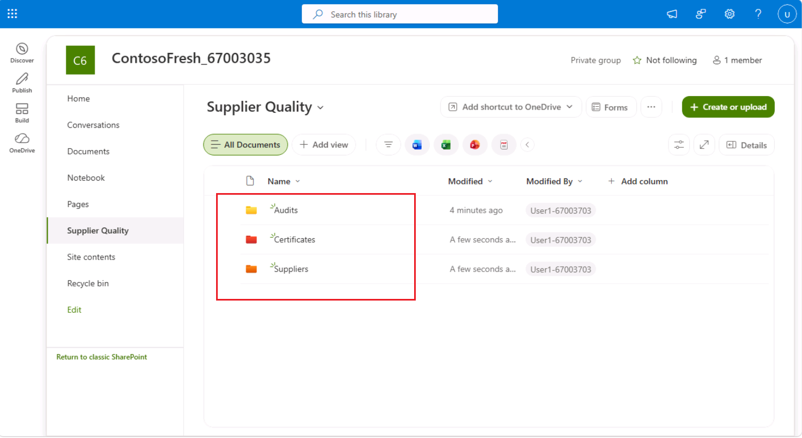
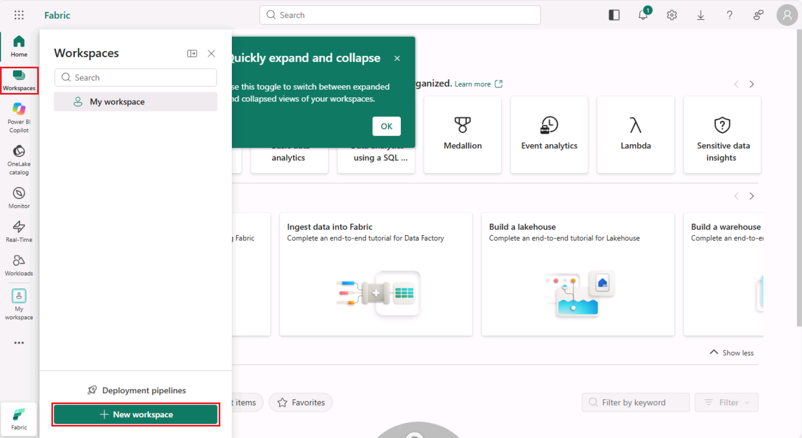
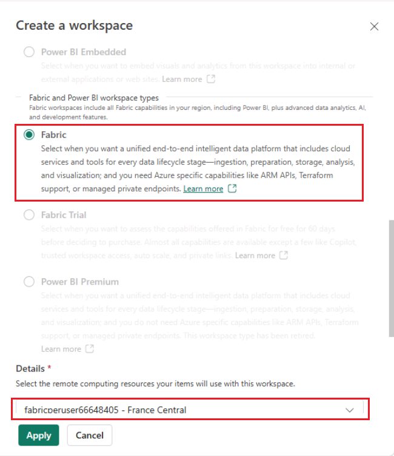

# Exercise 1.1: Explore data and Create resources in Microsoft Fabric

In this exercise, you will explore the supplier quality data stored in SharePoint. You will learn how to navigate the SharePoint site, locate the relevant data and prepare it for ingestion into OneLake.

## Task 1: Build SharePoint Document Library with Data

Supplier quality data is typically stored in SharePoint document libraries for Contoso Fresh. Each document library may contain multiple folders and files, organized by supplier, certificates, notices and audits.

1. In the lab VM open a web browser and navigate to SharePoint

    - SharePoint url: `https://lodsprodmslearnmca.sharepoint.com/`.

1. When prompted, sign in with the following credentials:

    - **Username:** `@lab.CloudPortalCredential(User1).Username`
    - **TAP:** `@lab.CloudPortalCredential(User1).TAP`

    

1. After signing in, select the **Build** tab from the left navigation pane.

    

1. Select the **Site** option under the **Start building** section.

1. On the **Select a site template** page, choose the **Standard team** template. Then select **Use template**.

    

1. Enter a name for the new site: `ContosoFresh_@lab.LabInstance.Id`. Select **Create** to create the new site.

    

1. Select **Go to site** to navigate to the newly created site.

1. In the newly created site, select **+ New** and then choose **Document Library**.

    

1. On the **Create new document library** page, select **Blank library**.

1. Enter name for the new document library: `SupplierQuality`. Select **Create** to create the document library.

## Task 2: Upload Data to SharePoint Document Library

1. Navigate to the **SupplierQuality** document library created in Task 1 by selecting it from the left navigation pane.

1. Select the **+ Create or upload** button, select the **Folder upload** option.

1. In the file picker dialog that appears, navigate to the **downloads** folder on the VM. Upload the following folders:

    - **Audits**
    - **Certificates**
    - **Suppliers**

    > [!NOTE]
    > Ensure that you upload these folders one at a time. **Suppliers** and **Audits** contain csv files while **Certificates** contains text files and subfolders.

    

## Task 3: Create a New Workspace

1. In the lab VM open a new tab in the browser and navigate to **Microsoft Fabric** using this url: `https://app.fabric.microsoft.com`.

1. If prompted, sign in with the same credentials used for the SharePoint site

1. On the left navigation pane, select **Workspaces** then select the **+ New Workspace** button.

    

1. In the **New Workspace** pane, provide this name for the workspace: `ContosoFresh_@lab.LabInstance.Id`. Under **Advanced** ensure that *Fabric* is selected as an option and a fabric capacity is provided.

    

1. Select **Apply** to create the new workspace.

## Task 3: Create a Lakehouse

1. In the newly created workspace **ContosoFresh_@lab.LabInstance.Id**, select the **+ New item** button. Search for and select `Lakehouse`.

    

1. Enter a name for the lakehouse: `SupplierQuality` and ensure that **Lakehouse schemas** is checked.

1. Select **Create** to create the new lakehouse.

    

## Next Steps

> Select **Next >** button to proceed to the next exercise.
