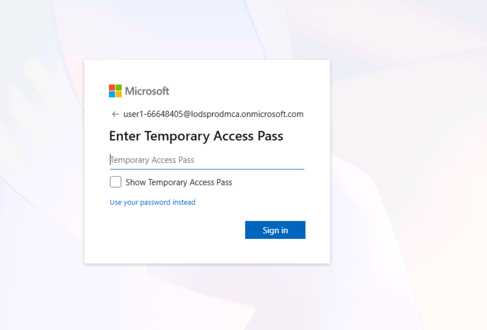
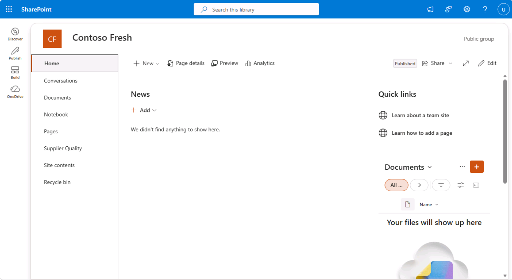
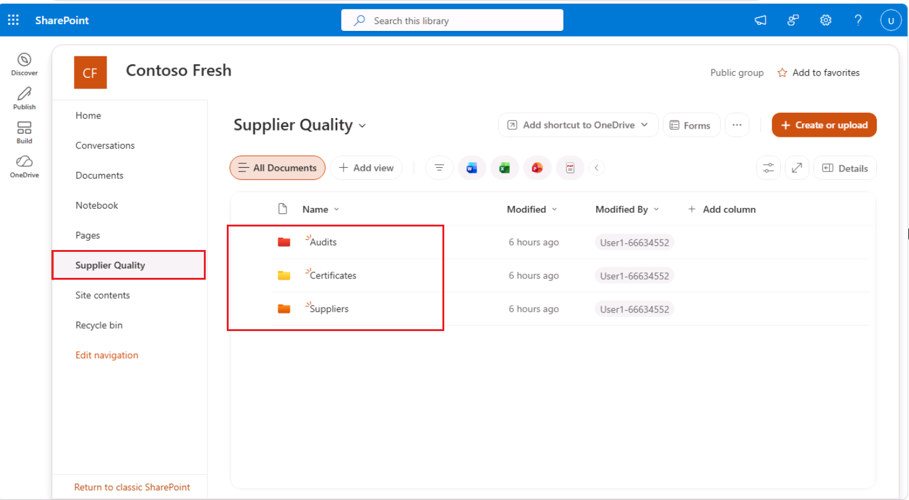
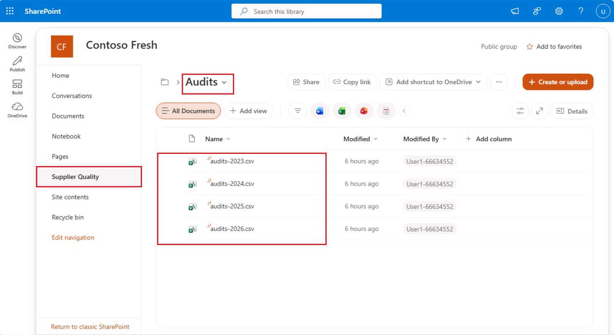
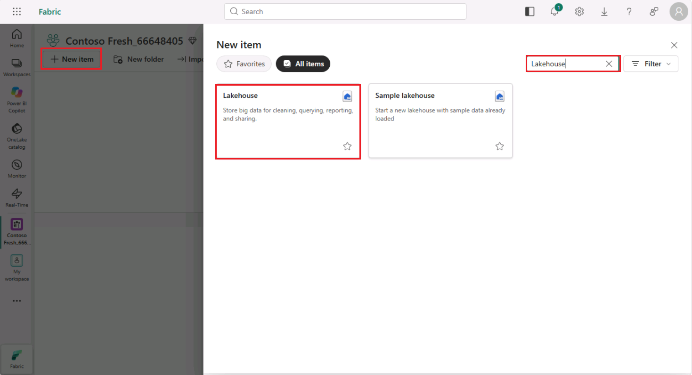
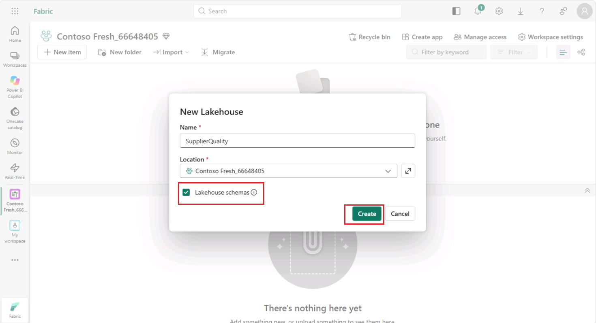

# Exercise 1.1: Explore data and Create resources in Microsoft Fabric

In this exercise, you will explore the supplier quality data stored in SharePoint. You will learn how to navigate the SharePoint site, locate the relevant data and prepare it for ingestion into OneLake.

## Task 1: Understand SharePoint Data

Supplier quality data is typically stored in SharePoint document libraries for Contoso Fresh. Each document library may contain multiple folders and files, organized by supplier, certificates, notices and audits.

1. In the lab VM open a web browser and navigate to the Contoso Fresh Supplier Quality site using this url: `https://lodsprodmca.sharepoint.com/sites/ContosoFresh`.

1. When prompted, sign in with the following credentials:

    - **Username:** `@lab.CloudPortalCredential(User1).Username`
    - **TAP:** `@lab.CloudPortalCredential(User1).TAP`

    

1. After signing in, you should have access to the Contoso Fresh Supplier Quality site.

1. Select the **Supplier Quality** document library from the left navigation pane.

    

1. There are multiple folders and files within the document library, organized by supplier, certificates, notices, and audits.

    

1. When you open the **Audits** folder, you will see a list of audits conducted for different suppliers. We need to make this data available as one table in OneLake for further analysis. Keep this in mind for the **Shortcut Transformation** step later in the exercise.

    

## Task 2: Create a New Workspace

1. In the lab VM open a new tab in the browser and navigate to **Microsoft Fabric** using this url: `https://app.fabric.microsoft.com`.

1. If prompted, sign in with the same credentials used for the SharePoint site

1. On the left navigation pane, select **Workspaces** then select the **+ New Workspace** button.

    

1. In the **New Workspace** pane, provide this name for the workspace: `ContosoFresh_@lab.LabInstance.Id`. Under **Advanced** ensure that *Fabric* is selected as an option and a fabric capacity is provided.

    

1. Select **Apply** to create the new workspace.

## Task 3: Create a Lakehouse

1. In the newly created workspace **ContosoFresh_@lab.LabInstance.Id**, select the **+ New item** button. Search for and select `Lakehouse`.

    

1. Enter a name for the lakehouse: `SupplierQuality` and ensure that **Lakehouse schemas** is checked.

1. Select **Create** to create the new lakehouse.

    

## Next Steps

> Select **Next >** button to proceed to the next exercise.
