# Exercise 1.2: Connect to Data in Microsoft Fabric

In this exercise, you will connect to the supplier quality data stored in SharePoint and make it available in Microsoft Fabric for further analysis. You will learn how to create a data connection and ingest the data into your lakehouse.

## Task 1: Create a Shortcut to SharePoint

1. In the **SupplierQuality** lakehouse, under the **Explorer** pane select the **(...)** next to **Files**.

1. Select **New shortcut**

    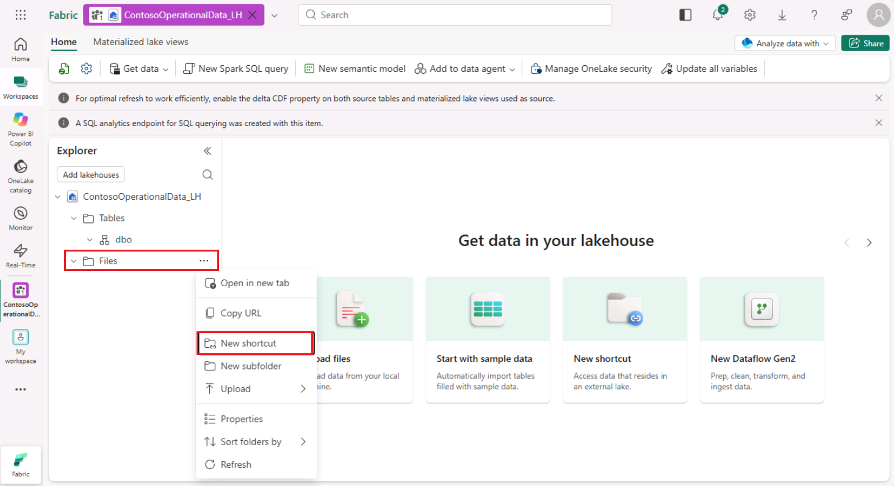

1. In the **New shorcut** menu, look for and select the **SharePoint Folder** option.

    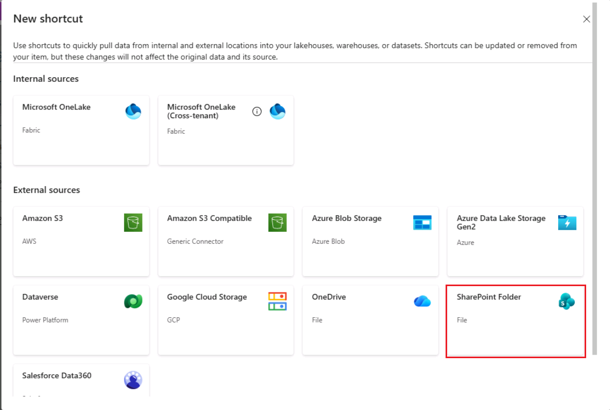

1. In the **SharePoint Folder** menu, select the **New connection** option to connect to your SharePoint site.

1. Under **Connection settings**, provide the following details:

    - **Site URL**: Enter `https://lodsprodmca.sharepoint.com/sites/ContosoFresh` or select the site from the list of options.
    - **Connection**: Select **Create new connection**
    - **Connection name**: Enter `supplierQuality-conn`
    - **Authentication kind**: Select **Organizational account**. Select sign in if required.

    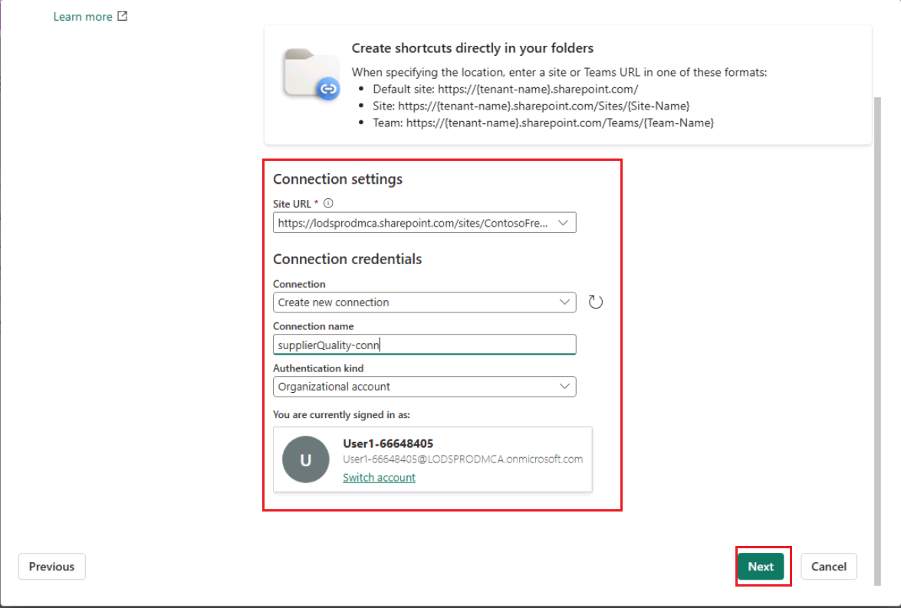

    > [!IMPORTANT]
    > When creating this connection, Fabric will try to automatically use an existing connection. If this happens, ensure that you select **Edit connection** to modify the connection settings so that you can create a new connection with the desired settings.

1. Select **Next** to proceed with the connection setup.

1. Under **Select a directory**, expand the **Supplier Quality** folder and select the **Certificates** folder. It contains the supplier certificates and recall procedures.

    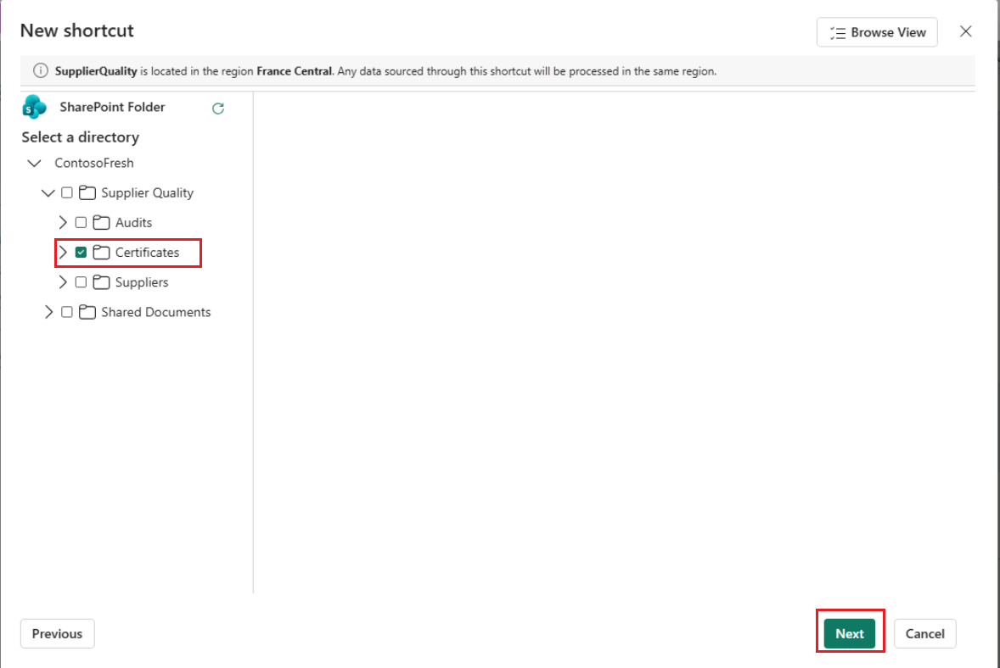

1. Select **Next**.

1. In the **Transform** pane, select the **Skip** button because we are not performing any transformations on the data at this stage. You will do Shortcut Transformations later when creating delta tables on **Task 2**.

    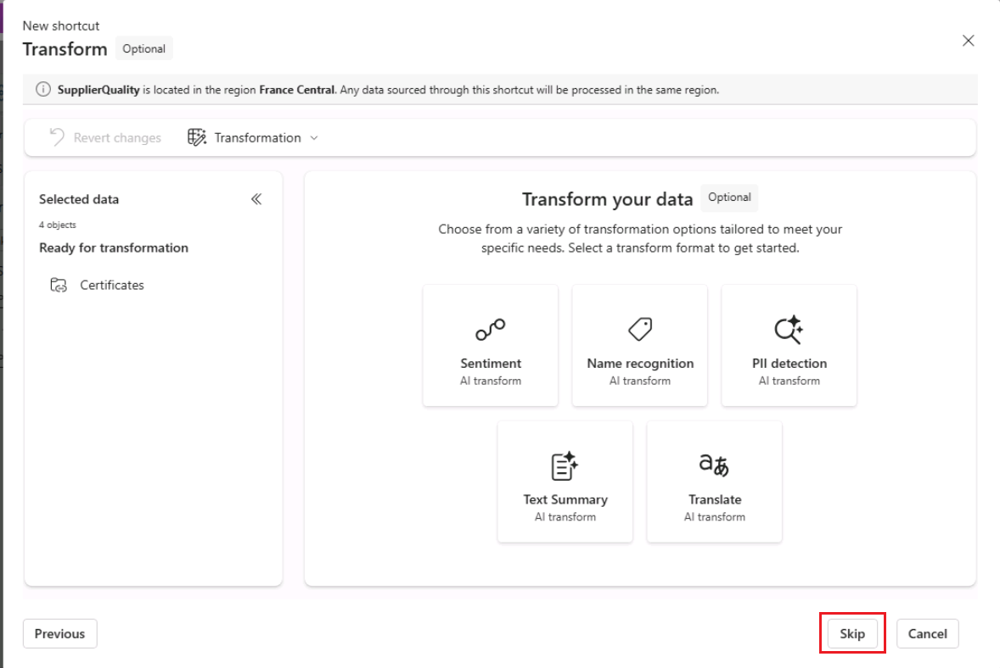

1. Under **Actions**, select the pencil icon and enter `SupplierQuality` as the name for the shortcut. Then select the checkmark to save the name.

    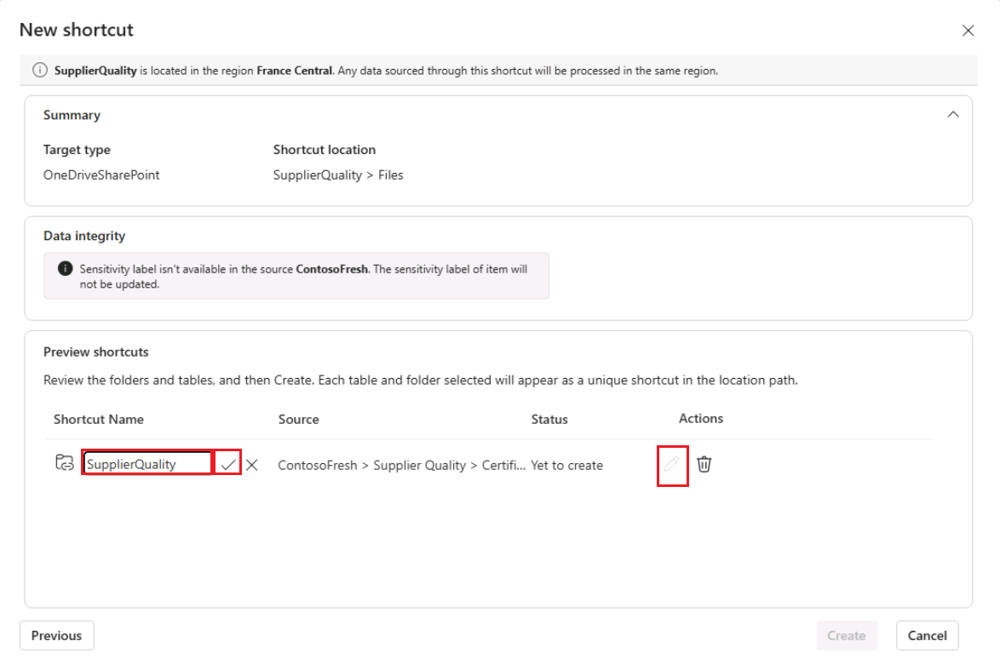

1. Select **Create** to create the shortcut to the SharePoint folder in your lakehouse.

1. Wait for the shortcut to be created and then refresh your lakehouse to see the newly added shortcut. You should see the **SupplierQuality** folder under **Files** in your lakehouse.

1. You should now see supplier certificates and recall procedures (files from the **Certificates** folder in SharePoint) available under the **SupplierQuality** folder in your lakehouse.

    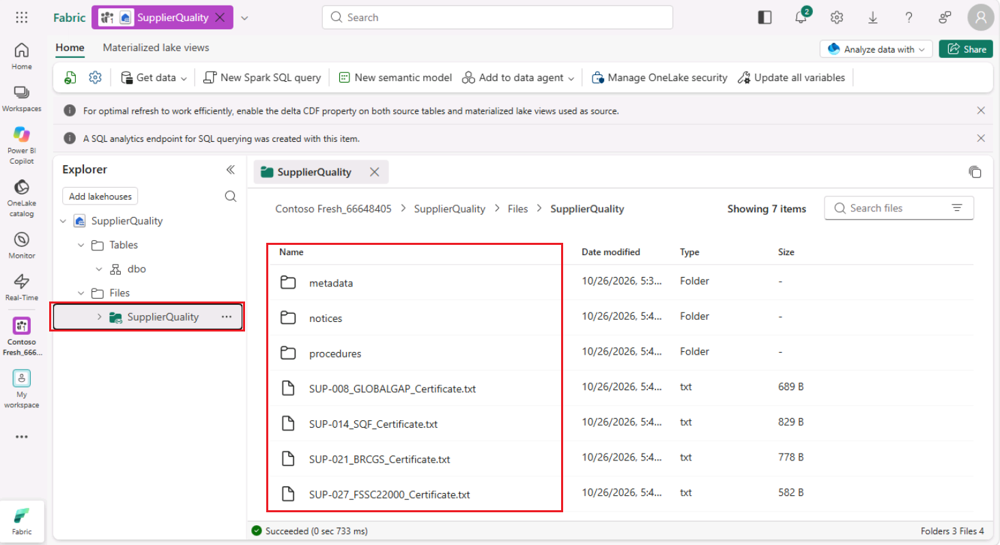

## Task 2: Create delta tables with Shortcut Transformations

1. In the **SupplierQuality** lakehouse, under the **Tables** select the **(...)** next to **dbo** and select **New table shortcut**.

    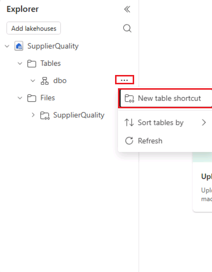

1. In the **New shortcut** menu, look for and select the **SharePoint Folder** option.

1. Select the **Existing connection** option and choose the connection you created earlier (**supplierQuality-conn**).

1. Select **Next**.

1. Expand the **Supplier Quality** folder then expand the **Certificates** folder. Select the **metadata** folder which contains the **supplier-certificates.csv** file.

    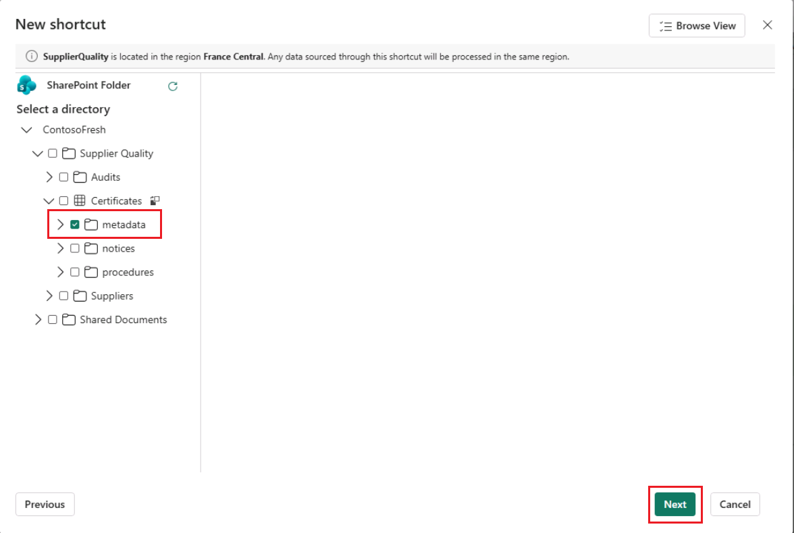

1. Select **Next**.

1. Configure the CSV transformation settings with comma delimiter and use **First row as header** option.

    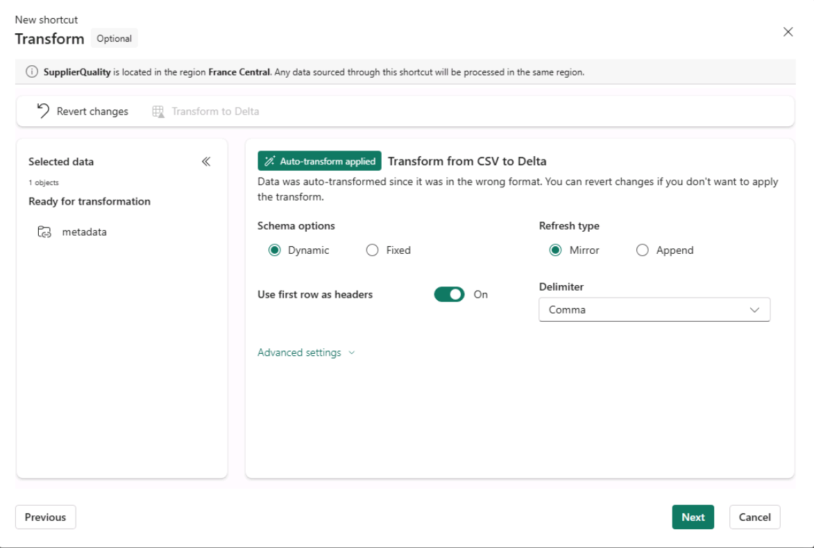

1. Select **Next** to proceed with the table creation.

1. Under **Actions**, select the pencil icon and enter `supplier_certificates` as the name for the shortcut. Then select the checkmark to save the name.

    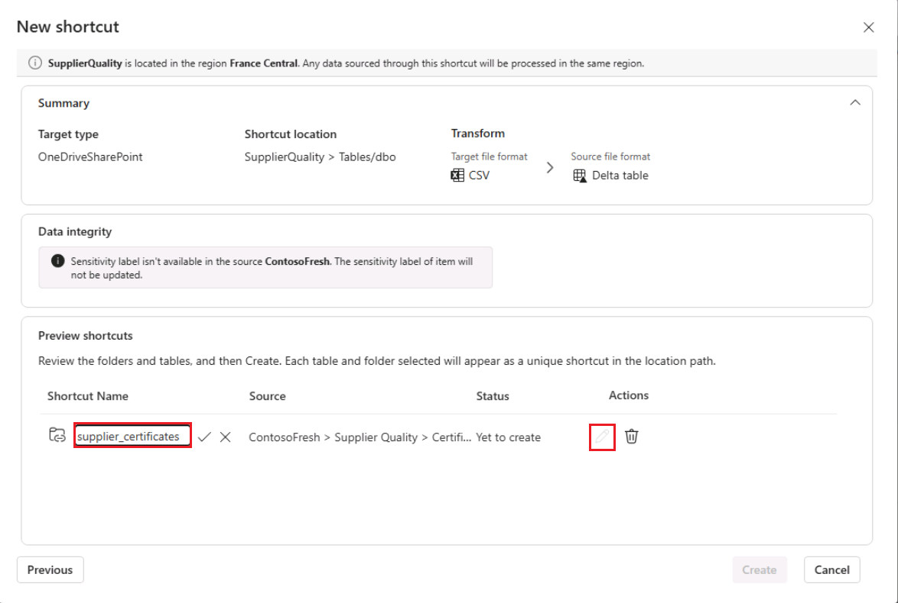

1. Select **Create** to create the table shortcut in your lakehouse.

1. Wait for a few seconds then under the **Tables**, select **(...)** next to **dbo** and select **Refresh** to see the newly added table shortcut.

1. You should now see the `supplier_certificates` table under **dbo** in your lakehouse.

1. Confirm that the table contains **4 certificate records** with distinct *certificate_id* values. Fabric can add *__filepath__*, *__corrupt__*, and *__ingestion_timestamp__* columns. Every *__corrupt__* value must be null; do not accept missing records or rows with parsing errors even if the transformation reports success.

1. Find the following **CERT-2026-014** for **SUP-014**:

    - Certificate type: **SQF Food Safety Code**.
    - Status: **Active**, with *is_current* true.
    - Expiration date: **2027-02-28**.
    - Audit score: **96**.
    - Document path: *certificates/SUP-014_SQF_Certificate.txt*, relative to **Files > SupplierQuality**.

1. Open that certificate through the document shortcut. Also open *notices/YG-2291_Supplier_Recall_Notice.txt* and the recall procedure under *procedures/* relative to **Files > SupplierQuality**. An active supplier certificate does not make a recalled lot safe: the recall notice still applies.

1. In the **SupplierQuality** lakehouse, under the **Tables** folder, select the **(...)** next to **dbo** and select **New table shortcut**.

1. In the **New shortcut** menu, look for and select the **SharePoint Folder** option.

1. Select the **Existing connection** option and choose the connection you created earlier (**supplierQuality-conn**).

1. Select **Next**.

1. Expand the **Supplier Quality** folder and select the **Suppliers** folder.

    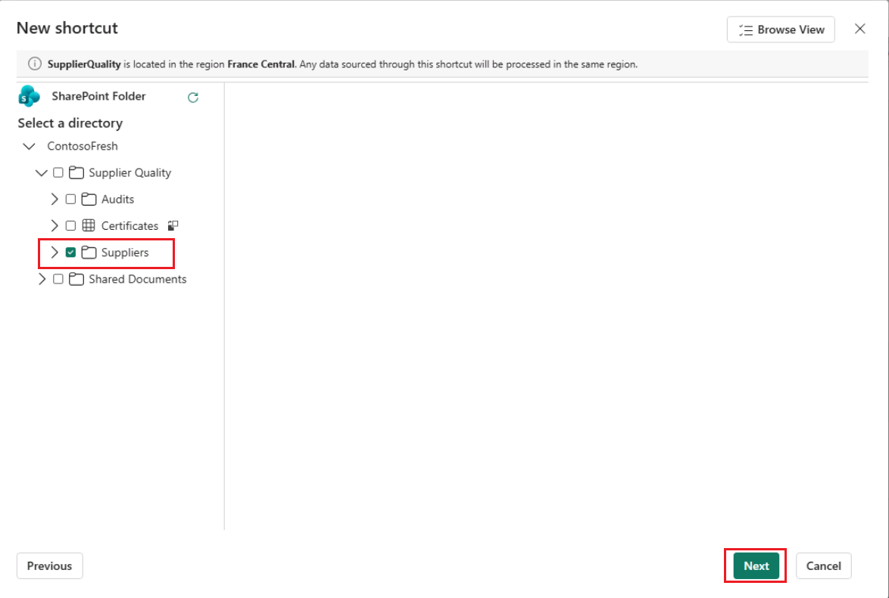

1. Select **Next** to proceed with the table creation.

1. Configure the CSV transformation settings with comma delimiter and use **First row as header** option.

    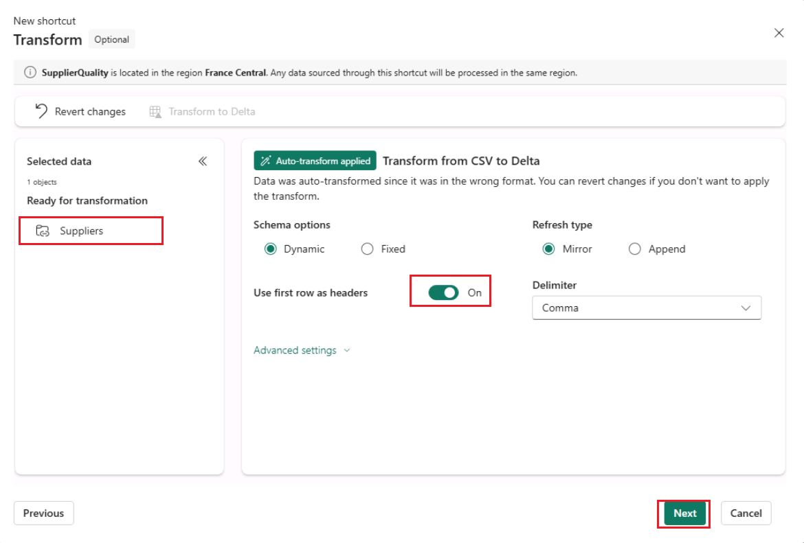

1. Select the pencil icon and enter `suppliers` as the name for the table shortcut.

    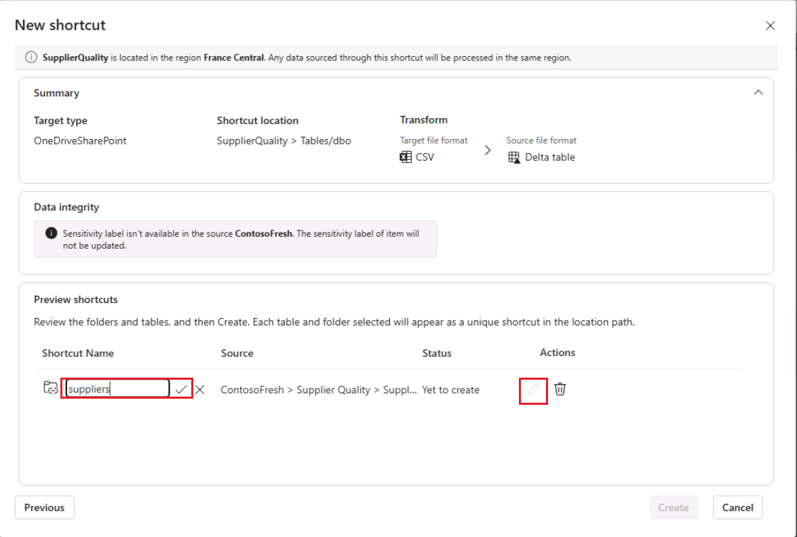

1. Select **Create** to create the table shortcut in your lakehouse.

1. Wait for a few seconds then under the **Tables**, select **(...)** next to **dbo** and select **Refresh** to see the newly added table shortcut.

1. You should now see the `suppliers` table under **dbo** in your lakehouse. You will use this table in **Exercise 2**.

## Task 3: Transform Audit Data

This task will guide you in consolidating and transforming the audit data for each supplier over a period of time. This data is available in the SharePoint library as 4 separate csv files.

1. In the **SupplierQuality** lakehouse, under the **Tables**, select the **(...)** next to **dbo** and select **New table shortcut**.

1. In the **New shortcut** menu, look for and select the **SharePoint Folder** option.

1. Select the **Existing connection** option and choose the connection you created earlier (**supplierQuality-conn**).

1. Select **Next**.

1. Expand the **Supplier Quality** folder then select the **Audits** folder.

    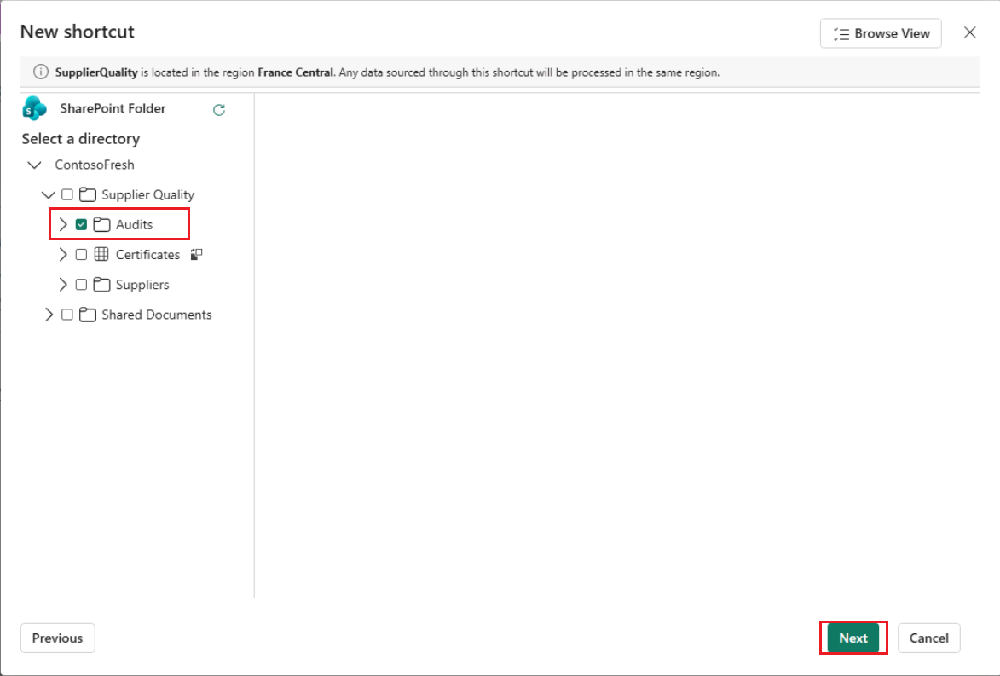

1. Select **Next** to proceed with the table creation.

1. Configure the CSV transformation settings with comma delimiter and use **First row as header** option.

    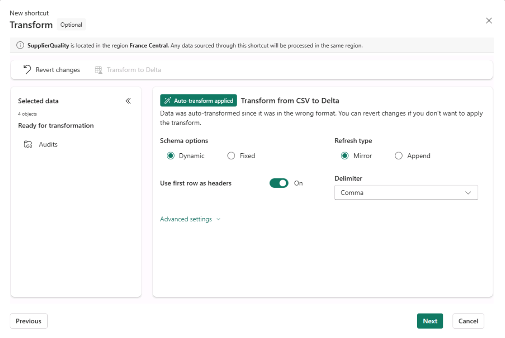

1. Select **Next**.

1. Enter `supplier_audits` as the name for the table shortcut and select the checkmark to save the name.

1. Select **Create** to create the table shortcut in your lakehouse.

1. Wait for a few seconds then under the **Tables**, select **(...)** next to **dbo** and select **Refresh** to see the newly added table shortcut.

1. You should now see the `supplier_audits` table under **dbo** in your lakehouse.

1. Confirm that the table contains **176 audit records** and pay attention to the *__filepath__* column which shows the different csv files each record came from.

    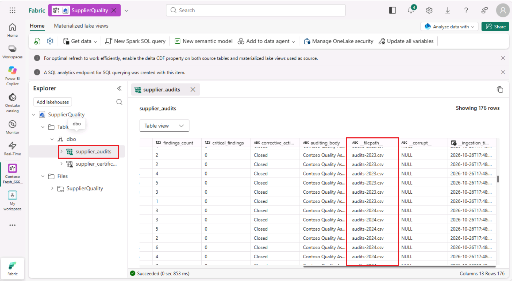

    > [!Knowledge]
    > When you are creating a table shortcut that consolidates data from multiple files, the files should be in the same folder and should share the same schema. That ensures the data can be combined correctly into a single table.

## Next Steps

> Select **Next >** to proceed to the next exercise.