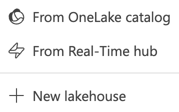

# Exercise 2.1: Prepare the notebook and data

In Module 1, you found the stores that hold lot YG-2291 today. The recall also asks where else the supplier's product has traveled. That answer is in five years of shipment history, which isn't in the lakehouse yet.

In this exercise, you connect the Module 2 notebook to your lakehouse and generate Contoso Fresh's shipment history in it. All of Module 2 runs in this one notebook.

## Open the notebook and add the lakehouse

1. In the workspace, open the notebook **module-2-shipment-history**.

    <!-- Screenshot TODO: exercise-2-1-open-notebook.png; show the notebook in the workspace item list. -->

    If a **Notebook Copilot Updates** window opens, select **Skip for now**.

    > [!Note] A notebook reads and writes files through its default lakehouse. Every cell in Module 2 finds the lakehouse this way, so attach the lakehouse you used in Module 1 before you run anything.

1. In the **Explorer** pane, select **Add data items** > **From OneLake catalog**.

    

1. Find the lakehouse. Its name is listed twice: one row is the lakehouse and the other is its SQL analytics endpoint. Select the row with the lakehouse icon, then select **Add**.

    <!-- Screenshot TODO: exercise-2-1-onelake-catalog.png; show the lakehouse selected, not its SQL analytics endpoint. -->

    The SQL analytics endpoint is a read-only SQL view of the lakehouse tables. The notebook needs the lakehouse itself because it writes files.

1. Check that the lakehouse shows under **OneLake** with a pin.

    <!-- Screenshot TODO: exercise-2-1-lakehouse-pinned.png; show the default lakehouse pin in Explorer. -->

    The pin marks the notebook's default lakehouse. Paths such as `Files/history` in the notebook point to it.

## Run the cells

You should run the code cells in order, one at a time. To run a cell, select it, then select **Run cell** to its left. Wait for a cell to finish before you run the next one.

If the session cannot start or a cell fails, retain the error and follow
[the Module 2 troubleshooting guidance](../README.md#if-a-module-2-cell-fails)
with the instructor. Keep the same notebook and lakehouse; do not substitute
another dataset or endpoint.

> [!Note] Each section below matches a cell in the notebook, and **Run the next code cell** moves you one code cell down.

## Cell 1: Generate data

Contoso Fresh's data comes from a generator in the first code cell. The cell writes two sets of CSV files:

- **Files/reference** holds the current state: suppliers, products, locations, carriers, trucks, lots and store inventory.
- **Files/history** holds five years of lot and shipment history, plus a late correction file from a carrier.

The cell's code is collapsed, so it reads **Input is hidden**.

1. Select the first code cell, then select **Run cell** to its left. 

    <!-- Screenshot TODO: exercise-2-1-run-cell.png; show Run cell beside the first cell with Input is hidden. -->

    > [!Note] The first run also starts the Spark session so it may take a few moments to complete.

1. Check that the output includes `Wrote lot_history, shipment_history (109,480 shipments) and the correction file`, followed by 10 row counts. The first 7 run from `suppliers: 4 rows` to `store_inventory: 1,533 rows`. The last 3 are `lot_history: 16,961 rows`, `shipment_history: 1,165,391 rows` and `corrections: 24 rows`.

    The data is in the lakehouse as plain CSV files. In the next two exercises, you write it as Iceberg tables.
