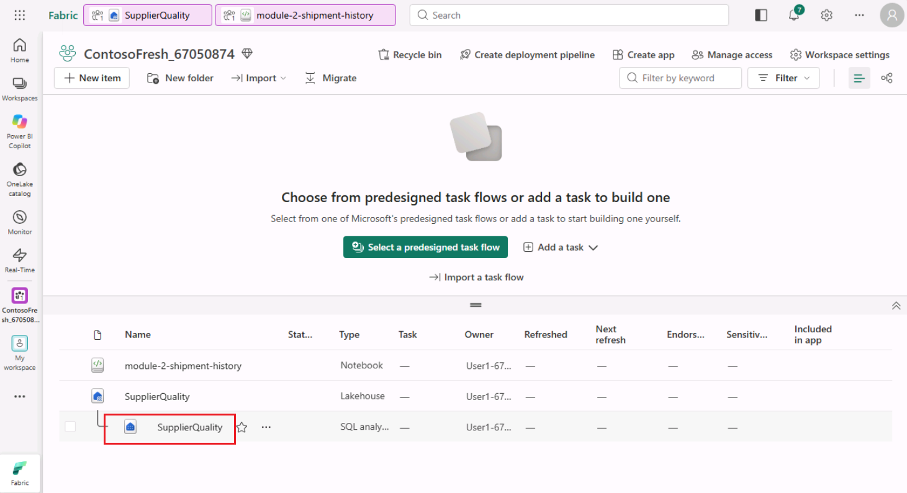
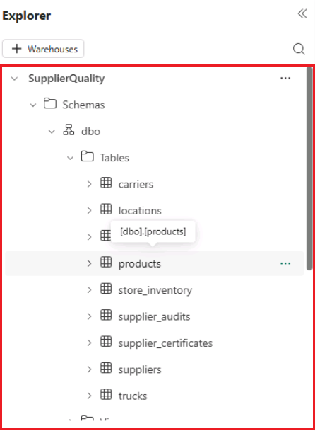
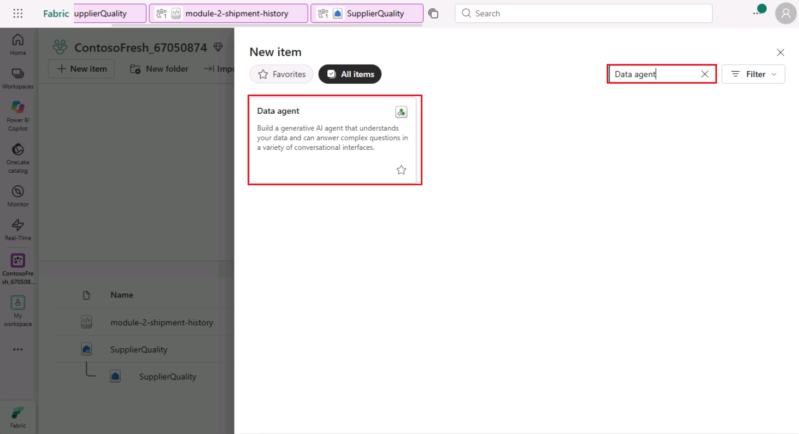
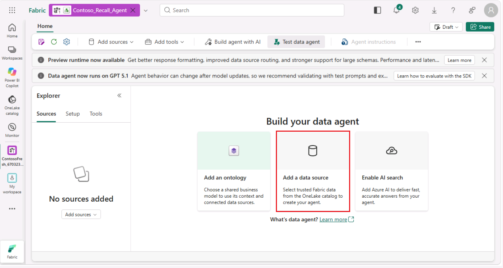
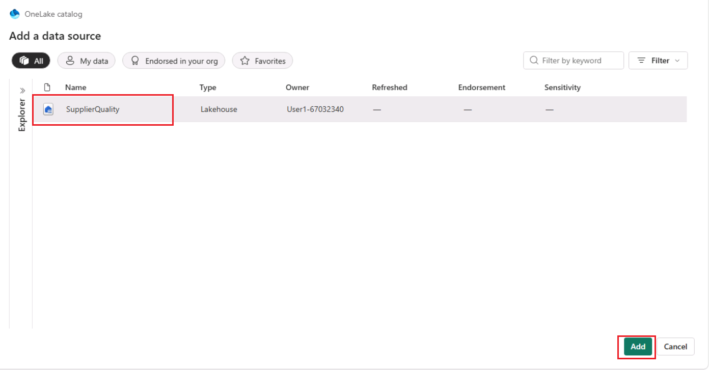
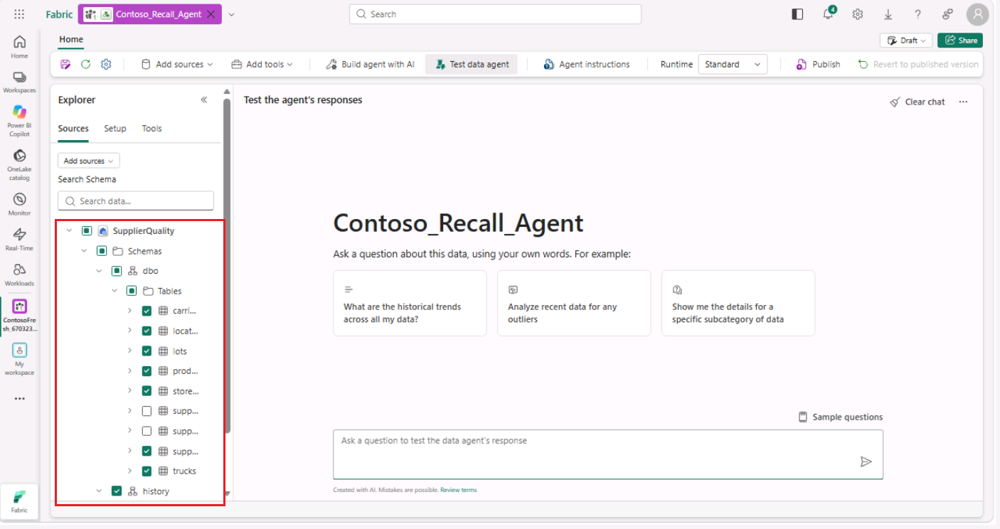
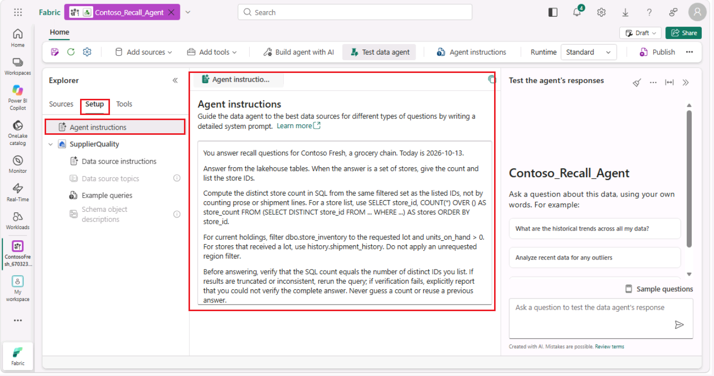
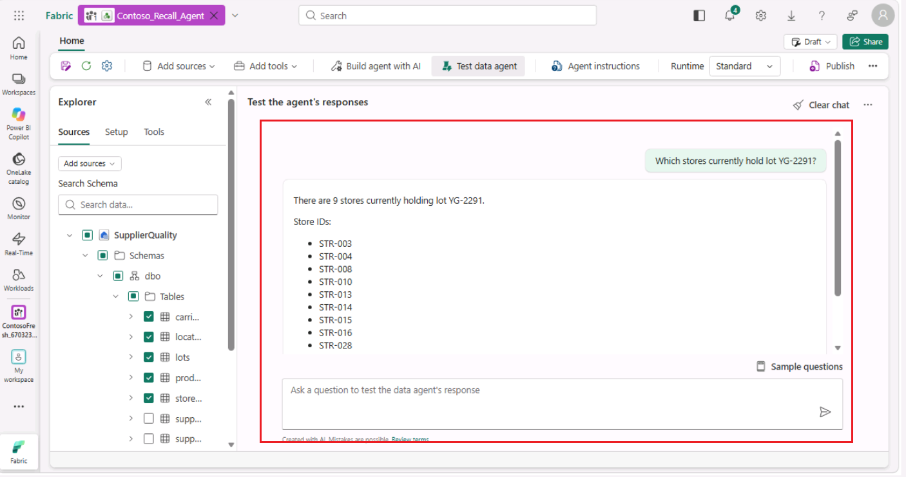

# Exercise 2.6: Ask the recall agent

Regional managers need answers before noon, without writing SQL. A Fabric data agent answers questions in plain language. It turns each question into SQL, runs the query against the tables you give it, and answers from the result.

In this exercise, you create a data agent over the lakehouse tables, choose its tables, ask it the recall questions, and publish it.

## Check your starting point

Cell 15 printed `13 stores received YG-2291, read through OneLake`. If it didn't, finish Exercise 2.3 first.

## Task 1: Refresh the SQL analytics endpoint

1. Navigate to the **ContosoFresh_@lab.LabInstance.Id** workspace in Microsoft Fabric.

1. In the workspace, select the **SupplierQuality** SQL analytics endpoint.

    

1. In the SQL analytics endpoint view, select the **...** menu next to **Schemas**.

1. Select **Refresh** to refresh the SQL analytics endpoint.

1. You should see all the schemas and tables listed under the SQL analytics endpoint.

    

## Task 2: Create the recall agent

1. Navigate to the **ContosoFresh_@lab.LabInstance.Id** workspace in Microsoft Fabric.

1. In the workspace, select the **+ New item** button and search for `Data agent` and select it.

    

1. In the **New Data Agent** pane, provide this name for the agent: `contoso_recall_agent`. Select **Create** to create the agent.

1. In the **New Data Agent** pane, select the **Add a data source** button.

    

1. In the **Add a data source** pane, select the **SupplierQuality** lakehouse as the data source for the agent.

    

1. Select **Add** to add the data source to the agent.

1. Once the **SupplierQuality** lakehouse is added, you need configure which tables the agent can query. Select the following tables for the agent:

    - Under **dbo**: *suppliers*, *products*, *locations*, *carriers*,
     *trucks*, *lots*, and *store_inventory*.
    - In **history**: *lot_history* and *shipment_history*.

    
    > [!NOTE]
    > Leave **supplier_certificates** and any later-module tables unselected. Selecting the entire lakehouse could include those additional tables.

1. On the **Explorer** tab, under **Setup** select **Agent instructions** and provide the following instructions for the recall agent:

    `You answer recall questions for Contoso Fresh, a grocery chain. Today is 2026-10-13. Answer from the lakehouse tables. When the answer is a set of stores, give the count and list the store IDs. Compute the distinct store count in SQL from the same filtered set as the listed IDs, not by counting prose or shipment lines. For a store list, use SELECT store_id, COUNT(*) OVER () AS store_count FROM (SELECT DISTINCT store_id FROM ... WHERE ...) AS stores ORDER BY store_id. For current holdings, filter dbo.store_inventory to the requested lot and units_on_hand > 0. For stores that received a lot, use history.shipment_history. Do not apply an unrequested region filter. Before answering, verify that the SQL count equals the number of distinct IDs you list. If results are truncated or inconsistent, rerun the query; if verification fails, explicitly report that you could not verify the complete answer. Never guess a count or reuse a previous answer.`

    

1. On the **Explorer** tab, under **Setup** select **Data source instructions** and provide the following instructions for the recall agent:

    `dbo.locations lists stores and distribution centers. Stores have location_type = 'store'. dbo.store_inventory is what each store holds now, one row per store and lot. history.shipment_history has one row per shipment line. Each line ships one lot to one store. history.lot_history has every lot with its supplier, production line, and production start time. Timestamps are in UTC. Contoso works in Europe/Paris time, so convert before you compare times of day. A related lot is a SUP-014 lot on production line AVD-L2 that starts between Sunday 22:00 and Monday 02:00 Paris time, on or after 2026-07-15 06:00 Paris time.`

## Task 3: Query and publish the recall agent

The two questions need different tables: store inventory for where the lot is now, and shipment history for every store that received it.

1. In chat box, enter this question to the recall agent:

    `Which stores currently hold lot YG-2291?`

1. Check that it shows 9 stores that are the same as the list of stores returned in one of the code cells in the Notebook.

    

1. In chat box, enter this question to the recall agent:

    `How many stores received lot YG-2291?`

1. Check that it shows 13 stores that received the lot, the same as the count returned in one of the code cells in the Notebook.

1. Select **Expand response** > **Steps completed**, then expand the step. The step shows the SQL the agent wrote and the tables it queried.

    > [!Help] Check the count and the distinct store IDs, not only the headline.
    > If they disagree, open **Steps completed** and compare the SQL result with cells 7 and 15. For current holdings, check the requested lot and positive inventory; for receiving stores, check distinct store IDs in shipment history. Confirm all 9 tables are ticked and ask again. If the mismatch persists, report it to the instructor; do not mark this check complete because a later answer merely sounds plausible.

1. Select **Publish**.

1. In the window that asks for a description, enter `Answers recall questions about Contoso Fresh lots, stores, and shipments.`. Leave **Also publish to Microsoft Copilot** off; this exercise does not require a separate Copilot publication. Then select **Publish**.

**Completion check:** The agent answers from the lakehouse tables: 9 stores hold YG-2291, and 13 received it. You published it with all 9 tables selected.

## Next steps

> Select **Next >** to proceed to the next exercise.
