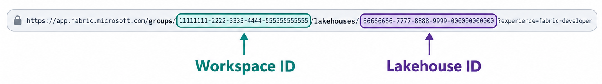

# Exercise 3.1: Get your token and run the console

In Modules 1 and 2, you brought Contoso Fresh's recall data into your lakehouse. The Recall Console is a browser app that reads that data straight from OneLake through the Table API, with no server in between.

For learning purposes, the console doesn't sign you in. Instead, you paste a bearer token: an access token that you request with Azure CLI and that the console sends with every request to OneLake. The token tells OneLake who is reading, and OneLake applies that reader's permissions and OneLake security roles before any data reaches the browser. A production app would sign users in with Microsoft Entra ID instead. Pasting the token makes the reader visible and easy to switch, which is what this lab needs.

Because the token decides who reads, the same app can show what different readers see. You use two identities:

- **Your user account**, in this module. It reads all of the recall data.
- **A service principal**, in Module 4. You add it to the security group that receives a OneLake security role limited to one supplier, then switch between the two identities in the console. Your account sees the lots of every supplier; the service principal sees only that supplier's lots, and OneLake blocks the tables outside its role.

The console sends the same requests for both identities and does no filtering of its own. Any difference in the data comes from OneLake security.

In this exercise, you install Node.js on the lab VM, start the console, sign in with a token for your own account, and load the data to check that everything works.

## Check your starting point

The console reads 6 tables from the `dbo` schema of your lakehouse. They include `dbo.supplier_certificates` from Module 1 and `dbo.recall_temperature_status`, the cold-chain snapshot the instructor supplies. If you haven't finished Modules 1 and 2, finish them first. If the snapshot is missing, ask the instructor; don't create it yourself.

## Task 1: Install Node.js

The console is a Vite app, so it needs Node.js to install its packages and run a local web server.

1. On the lab VM, select **Start**, type `Terminal`, then select **Terminal**.

1. Install the long-term support (LTS) release of Node.js with winget:

    ```powershell
    winget install --id OpenJS.NodeJS.LTS --exact --source winget --accept-package-agreements --accept-source-agreements
    ```

    If Windows asks whether to allow the app to make changes to your device, select **Yes**.

1. When the installation finishes, close Terminal and open it again so that it finds Node.js.

1. Check that Node.js and npm are installed:

    ```powershell
    node --version
    npm --version
    ```

    Each command prints a version number.

    > [!Note] If `npm` fails with **running scripts is disabled on this system**, run `Set-ExecutionPolicy -Scope CurrentUser -ExecutionPolicy RemoteSigned`, then run `npm --version` again.

## Task 2: Start the console

The console's source code is in the **console** folder in your **Downloads** folder.

1. In Terminal, go to the console folder:

    ```powershell
    cd $HOME\Downloads\console
    ```

1. Install the console's packages:

    ```powershell
    npm ci
    ```

    `npm ci` installs the exact package versions listed in `package-lock.json`. It can take a minute or two.

1. Start the console:

    ```powershell
    npm run dev
    ```

1. Check that Vite prints a **Local** address, normally `http://127.0.0.1:5173/`.

    Leave this Terminal tab open. It serves the console for the rest of the exercise.

1. Open the **Local** address in the browser. The console opens on the **Sign in with an access token** page.

    <!-- Screenshot TODO: exercise-3-1-sign-in-page.png; show the Sign in with an access token page. -->

## Task 3: Get your access token

The first Terminal tab is busy running the console, so you request the token in a second tab. OneLake accepts tokens issued for the Azure Storage audience, `https://storage.azure.com`.

1. In Terminal, select **+** in the tab bar to open a new tab.

1. Sign in to Azure CLI:

    ```powershell
    az login --allow-no-subscriptions
    ```

1. When the sign-in window opens, sign in with your lab account:

    - **Username:** `@lab.CloudPortalCredential(User1).Username`
    - **TAP:** `@lab.CloudPortalCredential(User1).TAP`

    If Azure CLI asks you to select a subscription, press **Enter** to keep the default.

1. Request a token and copy it to the clipboard:

    ```powershell
    az account get-access-token --resource https://storage.azure.com --query accessToken -o tsv | Set-Clipboard
    ```

    The command prints nothing. The token is now on the clipboard.

1. On the console's sign-in page, paste the token into **My account access token**.

1. Check that the line under the field shows **User**, your user name, and the time left. A warning about the audience means the token was issued for the wrong resource: run the previous command again and paste the new token.

    > [!IMPORTANT]
    > Treat the token like a password. Don't paste it into source code, `.env` files, chat, or URLs, and keep it out of screenshots. A token usually lasts 60 to 90 minutes.

## Task 4: Find your workspace and lakehouse IDs

The console also needs to know which lakehouse to read. Fabric shows the workspace ID and the lakehouse ID in the address of the lakehouse page.

1. In a new browser tab, go to `https://app.fabric.microsoft.com` and open the **ContosoFresh_@lab.LabInstance.Id** workspace.

1. Open the **SupplierQuality** lakehouse that you used in Modules 1 and 2.

    The workspace lists the name twice: one item is the lakehouse and the other is its SQL analytics endpoint. Open the item whose type is **Lakehouse**.

1. Look at the browser's address bar. The address has this shape:

    `https://app.fabric.microsoft.com/groups/<workspace-id>/lakehouses/<lakehouse-id>?experience=...`

    - The **workspace ID** is the value after `/groups/`.
    - The **lakehouse ID** is the value after `/lakehouses/`, up to the `?`.

    

    Each ID is 36 characters long: five groups of letters and digits separated by hyphens. If the address doesn't contain `/lakehouses/`, you opened the SQL analytics endpoint. Go back to the workspace and open the **Lakehouse** item.

1. Copy the workspace ID and paste it into **Workspace ID** on the console's sign-in page.

1. Copy the lakehouse ID and paste it into **Lakehouse ID**. Keep the default **Table API endpoint**.

    The console saves both IDs in the browser and fills them in next time. It never saves the token.

## Task 5: Sign in and load data

1. On the console's sign-in page, select **Sign in**.

1. Select **Load data**.

1. Check that the toolbar shows **6/6 tables loaded** with your name, and that the dashboard fills in for lot **YG-2291**.

    <!-- Screenshot TODO: exercise-3-1-data-loaded.png; show the dashboard with 6/6 tables loaded. -->

    The browser sent each request straight to the OneLake Table API with your token. OneLake checked your permissions and returned the rows your account is allowed to read.

> [!Help] If your identity shows **expired**, request a new token as in Task 3, then select **Identities** > **Replace token**. If fewer than 6 tables load, select **Sign out**, check the workspace and lakehouse IDs against the lakehouse address, and sign in again. If a table is still missing, check that you finished Modules 1 and 2, and ask the instructor about `dbo.recall_temperature_status`.

**Completion check:** The console runs on the lab VM, you signed in with your own access token, and **Load data** loaded all 6 tables for lot YG-2291.
