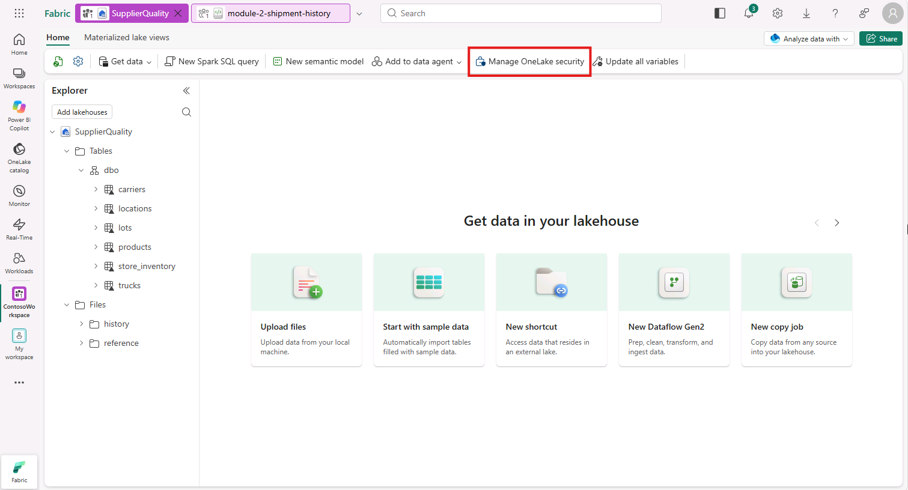
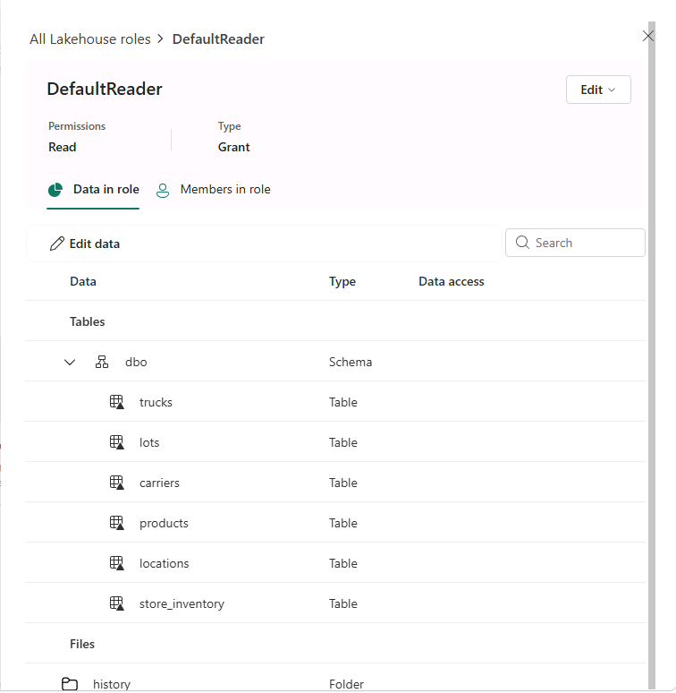
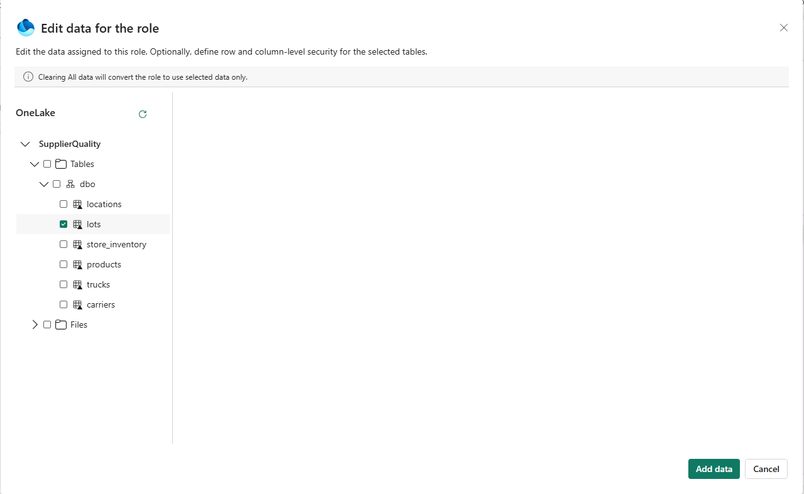
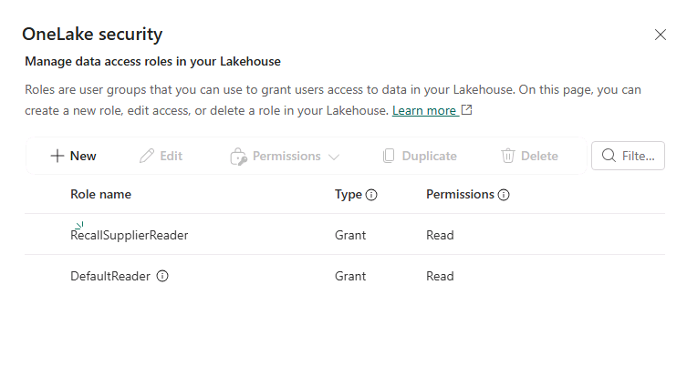

# Exercise 4.1: Create a OneLake security role

In [Exercise 2.6](../module-2/exercise-2-6-ask-the-recall-agent.md), you published a data agent over the recall tables. Selecting tables for an agent tells it what it can query; it doesn't define which data each colleague is allowed to read.

OneLake security defines that access on the data itself. In this exercise, you work as an admin in your own lakehouse to explore security roles, inspect **DefaultReader**, and create a role that grants access to **dbo.lots**, one of the tables you created in [Exercise 2.2](../module-2/exercise-2-2-explore-current-state-through-onelake.md).

## Check your starting point

1. Open the lakehouse you attached to the Module 2 notebook. Expand **Tables** > **dbo** and check that **lots** is present.
1. Confirm that Exercise 2.6's cell 25 printed `The SQL analytics endpoint reads all 9 tables.`

    The tables were written as Iceberg. Cell 25 made their virtual Delta logs available and refreshed the SQL analytics endpoint. OneLake security supports row and column rules on these virtualized Iceberg tables.

1. Use your lab account, which has workspace **Admin** access, to configure security in your own lakehouse.

    > [!Note] Workspace Admins, Members, and Contributors retain access to all data through their elevated permissions. You'll add your own account to the role to learn how membership works, but the role won't restrict your own reads. This exercise checks the configuration, not restricted-reader behavior.

If the table or required admin access is missing, stop and ask the instructor. Don't change workspace roles.

## Understand OneLake security roles

A OneLake security role belongs to a Fabric item, such as a lakehouse. It grants its members access to selected data in that item.

| Part of a role | What it controls |
|---|---|
| **Permissions** | **Read** allows reading. **ReadWrite** also allows supported write operations; it can't be combined with row or column restrictions. |
| **Type** | **Grant** adds access. OneLake security doesn't have a Deny role that overrides another grant. |
| **Data in role** | The tables, schemas, or folders members can access, with optional row and column rules on tables. |
| **Members in role** | The Microsoft Entra users, groups, or other supported identities that receive the access. |

Item **Read** permission lets someone open the lakehouse. A OneLake security role defines which data they can read inside it. These are separate permissions.

Grants are additive. A restricted role doesn't take away broader access from another role. When granting restricted access, you must also check for broader grants through other roles or groups. You don't need to change your own admin access for this walkthrough.

## Inspect DefaultReader

Lakehouses start with a **DefaultReader** role. By default, it grants **Read** access to all lakehouse data to identities with the item's **ReadAll** permission. Membership is based on that permission, rather than a list you must maintain one user at a time.

1. In the lakehouse's item menu, select **Manage OneLake security**.

    

1. On the **All lakehouse roles** tab, open **DefaultReader**.
1. Inspect **Data in role** and **Members in role**. Compare the configured scope and membership with the default behavior above.

    

1. Return to the security pane and open **Members**. Review the listed users and groups. Select a listed member, if available, and inspect **Roles** and **Granted data**.

    > [!Note] Adding someone to a new role doesn't remove DefaultReader access. If membership comes from a permission group, you can't remove just that user from the role's member list. Inspect the configuration here without changing DefaultReader or existing permissions.

With OneLake security enabled, **ReadAll** provides access through DefaultReader; it isn't a separate grant that bypasses the role. Changing or deleting DefaultReader affects everyone who relies on it, which is why this exercise only inspects it.

## Create the table-access role

Start with access to one whole table. In Exercise 4.2, you'll narrow that same role to selected rows and columns.

1. On **Roles**, select **New**.
1. Enter ++RecallSupplierReader++ as the **Role name**. Keep **Type of role** as **Grant** and select **Read** under **Select Grant permissions**.

    Use the name exactly as shown: role names must start with a letter and contain only letters and numbers. If **RecallSupplierReader** already exists, open it and inspect its data and membership instead of creating a duplicate.

1. Select **Next**.
1. Choose **Selected data**, then select **Edit**.
1. Expand **Tables** > **dbo** and select only **lots**. Don't select the entire schema, **All data**, or anything under **Files**.

    

    Granting access to raw CSV files under **Files/reference** would give the reader a separate route to the source data. Table rules don't filter those files.

1. Select **Add data**, then **Next**.
1. In **Add members to your role**, enter your lab account's email address and select your matching identity. Don't select an entire permission group through **Advanced configuration**.
1. Review the selection, then select **Create**. Wait for the success notification.

    

**Completion check:** **RecallSupplierReader** grants **Read** access to only **dbo.lots**, with your lab account as its member. You can explain how DefaultReader can grant broader access and why your admin account still has access to all data. This check verifies the role's configuration, not effective restricted access.

Continue to [Exercise 4.2: Add row and column security](exercise-4-2-add-row-and-column-security.md).

## Learn more

- [How OneLake security controls data access](https://learn.microsoft.com/fabric/onelake/security/data-access-control-model)
- [Create and manage OneLake security roles](https://learn.microsoft.com/fabric/onelake/security/create-manage-roles)
