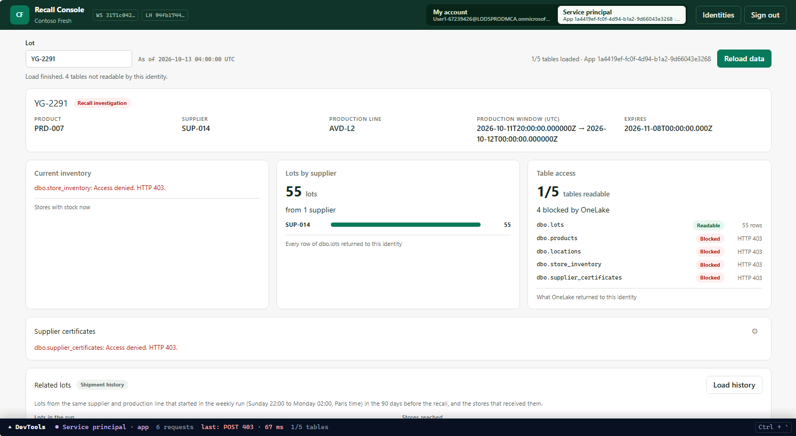
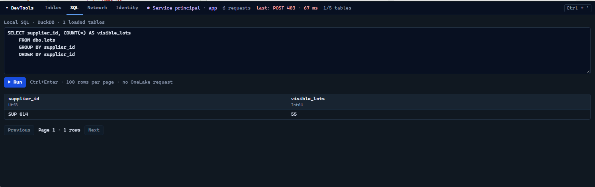
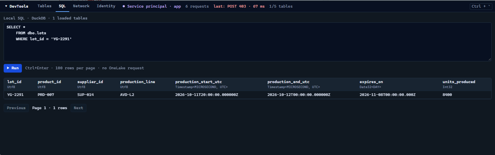
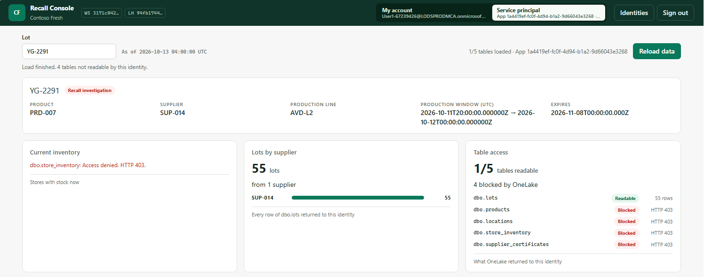

# Exercise 4.3: Query secured data through SQL

In Exercise 4.2, you added row and column rules to the **RecallSupplierReader** role. Your lab account is a workspace Admin, so OneLake security doesn't restrict your own reads. To see the rules apply, you need an identity that gets its access only from the role.

Apps and automated jobs usually don't read data as a person. They use a service principal: an identity for an application in Microsoft Entra ID.

In this exercise, you create a service principal, add it directly to **RecallSupplierReader**, and sign in to the Recall Console with its token. The console reads OneLake directly through the Table API, so OneLake applies the role before any data reaches the browser. You then query what OneLake returned with the console's SQL tab, without any supplier filter. Finally, you compare the service principal's dashboard with your own.

## Check your starting point

- In your **SupplierQuality** lakehouse, **RecallSupplierReader** grants **Read** on only **dbo.lots**, with the **SUP-014** row rule and **supplier_unit_cost_eur** hidden, as in Exercise 4.2.
- The console you deployed in Exercise 3.3 is open, with **My account** signed in and **5/5 tables loaded** in the toolbar.
- Azure CLI is signed in with your lab account in Terminal, as in Exercise 3.1.

> [!Help]
> If **My account** shows **expired** in the console's header, request a new token in the second Terminal tab and copy it to the clipboard:
>
> ```powershell
> az account get-access-token --resource https://storage.azure.com --query accessToken -o tsv | Set-Clipboard
> ```
>
> If Azure CLI asks you to sign in again, run `az login --allow-no-subscriptions`, sign in with your lab account, and run the command again.
>
> In the console, select **Identities**. In the **My account** section, paste the token into **My account access token**, then select **Replace token**.

## Task 1: Create the service principal

You create an app registration, its service principal, and a client secret with Azure CLI. The service principal uses the secret to request its token in Task 3.

1. In Terminal, select the second tab, where you signed in to Azure CLI in Exercise 3.1. If you closed it, select **+** in the tab bar to open a new tab.

1. Check that Azure CLI is still signed in with your lab account:

    ```powershell
    az account show --query user.name -o tsv
    ```

    The command prints your lab user name. If it prints an error instead, run `az login --allow-no-subscriptions` and sign in with your lab account.

    Keep this Terminal tab open until the end of this exercise. The variables you create in this task exist only in this tab.

1. Create an app registration and its service principal. The name includes your lab instance ID, so it's unique:

    ```powershell
    $appId = az ad app create --display-name "recall-supplier-reader-@lab.LabInstance.Id" --query appId -o tsv
    $spId = az ad sp create --id $appId --query id -o tsv
    $tenantId = az account show --query tenantId -o tsv
    ```

1. Check that each variable holds an ID:

    ```powershell
    $appId; $spId; $tenantId
    ```

    The command prints three IDs, each 36 characters long. `$appId` is the application (client) ID that identifies the app. `$spId` is the service principal's object ID: the identity you add to the OneLake security role.

1. Create a client secret that expires in two hours:

    ```powershell
    $expires = (Get-Date).ToUniversalTime().AddHours(2).ToString('yyyy-MM-ddTHH:mm:ssZ')
    $secret = az ad app credential reset --id $appId --display-name recall-lab --end-date $expires --query password -o tsv
    ```

    The secret stays in the `$secret` variable and isn't printed. Azure CLI prints a warning that reminds you to protect the credential.

    > [!IMPORTANT]
    > The secret works like a password for the service principal. Don't print it, paste it, or save it in a file.

## Task 2: Add the service principal to the role and workspace

Add the service principal directly to **RecallSupplierReader** in the lakehouse's OneLake security pane. It receives the role's table, row, and column permissions without joining a security group. Also add the service principal to the workspace as a Viewer.

1. In Terminal, copy the service principal's object ID to the clipboard:

    ```powershell
    $spId | Set-Clipboard
    ```

1. In Fabric, open the **SupplierQuality** lakehouse in your **ContosoFresh_@lab.LabInstance.Id** workspace, then select **Manage OneLake security** from the lakehouse's item menu.

1. Open **RecallSupplierReader**, select **Members in role**, then select **Add members**.

1. In **Add members to your role**, paste the service principal's object ID. Select the matching **recall-supplier-reader-@lab.LabInstance.Id** identity from the suggestions, then select the check icon to confirm.

1. Wait for the success notification, then check that **Members in role** lists the service principal alongside your lab account.

    Don't add it to **DefaultReader**, grant it **ReadAll**, or give it a workspace role. Those grants could let it read data outside **RecallSupplierReader**.

> [!Help] If the new service principal doesn't appear in the suggestions, wait a minute and try again. If adding it fails, keep the error and ask the instructor. Don't work around the error by granting broader access.

1. Navigate to the **ContosoFresh_@lab.LabInstance.Id** workspace, and select **Manage access**.

1. Select **Add people or groups** and paste in the service principal ID from the clipboard. Select the matching identity from the suggestions.

1. Make sure the drop down has **Viewer** selected as the role, and then choose **Add**.

## Task 3: Get the service principal's token

To keep your own Azure CLI sign-in in this tab, you sign in as the service principal in a separate Azure CLI configuration folder, then switch back.

1. Sign in as the service principal, request its token, and copy the token to the clipboard:

    ```powershell
    $env:AZURE_CONFIG_DIR = Join-Path $env:TEMP 'recall-spn-azure'
    az login --service-principal --username $appId "--password=$secret" --tenant $tenantId --allow-no-subscriptions --output none
    az account get-access-token --resource https://storage.azure.com --query accessToken -o tsv | Set-Clipboard
    Remove-Item Env:AZURE_CONFIG_DIR
    ```

    The last command returns this tab to your own Azure CLI sign-in. The service principal's token is now on the clipboard.

> [!Help] If `az login` reports that the application wasn't found or that the secret is invalid, the new app registration isn't available yet. Wait a minute, then run the four commands again.

## Task 4: Sign in as the service principal

The console holds two identities at once, **My account** and **Service principal**, and keeps the loaded data of each one separately.

1. In the console's header, select **+ Service principal**. The **Identities** dialog opens.

1. In the **Service principal** section, paste the token into **Service principal access token**.

1. Check that the line under the field shows **Application**, **App** followed by your app ID, and the time left. A warning that says **This is a user token, not a service principal token** means you pasted your own token: repeat Task 3 and paste again.

1. In the **Service principal** section, select **Sign in**, then close the dialog.

    The header now shows **My account** and **Service principal**, with **Service principal** selected.

1. Select **Load data**.

1. Check that the message under the toolbar says **Load finished. 4 tables not readable by this identity.**

    

    The console sent the same requests as for your account, this time with the service principal's token.

> [!Help] If **dbo.lots** is also blocked, return to **Manage OneLake security** and check that the service principal is listed directly in **RecallSupplierReader** and that the role includes **dbo.lots**. Correct any missing membership as in Task 2, then select **Reload data**. If it is still blocked, keep the error and ask the instructor. If the identity shows **expired**, repeat Task 3, then select **Identities** > **Replace token** in the **Service principal** section.

## Task 5: Query the allowed rows

The console keeps the data OneLake returned to each identity in a separate DuckDB database in the browser. The **SQL** tab in DevTools queries that local copy and sends nothing to OneLake. A row or column that isn't there is one OneLake didn't return to the active identity.

1. With **Service principal** selected in the header, select **DevTools** at the bottom of the window, or press **Ctrl+`**.

1. Select **SQL**. Check that the label above the editor ends with **1 loaded tables**: only **dbo.lots** reached the browser for the service principal.

1. Replace the text in the editor with this query, then select **▶ Run** or press **Ctrl+Enter**. It deliberately has no supplier filter:

    ```sql
    SELECT lot_id, product_id, supplier_id, production_line
    FROM dbo.lots
    ORDER BY lot_id
    LIMIT 20
    ```

1. Check that it returns rows and that every row has **supplier_id** equal to **SUP-014**.

1. Run this query to check all the suppliers in the data, not just the first 20 rows:

    ```sql
    SELECT supplier_id, COUNT(*) AS visible_lots
    FROM dbo.lots
    GROUP BY supplier_id
    ORDER BY supplier_id
    ```

1. Check that exactly one supplier appears: **SUP-014**, with **55** lots.

    

The console asked OneLake for the whole **dbo.lots** table. The row rule filtered it before any row reached the browser, so you didn't need `WHERE supplier_id = 'SUP-014'` to make the policy apply.

## Task 6: Try to read rows outside the rule

1. Run this query:

    ```sql
    SELECT lot_id, supplier_id
    FROM dbo.lots
    WHERE supplier_id <> 'SUP-014'
    ```

1. Check that the results show **0 rows**. Asking explicitly for another supplier can't bring back rows that OneLake never returned.

1. Check that an allowed recalled lot is still readable:

    ```sql
    SELECT lot_id, supplier_id, production_line
    FROM dbo.lots
    WHERE lot_id = 'YG-2291'
    ```

1. Check that the result includes **YG-2291**, **SUP-014**, and **AVD-L2**, as in Exercise 2.2.

The positive check matters: an empty table would also return zero rows for the query about other suppliers.

## Task 7: Try to read the hidden column

1. Run this query:

    ```sql
    SELECT lot_id, supplier_unit_cost_eur
    FROM dbo.lots
    WHERE lot_id = 'YG-2291'
    ```

1. Check that the query fails with **Query rejected or failed** and returns no cost value.

1. Run this query:

    ```sql
    SELECT *
    FROM dbo.lots
    WHERE lot_id = 'YG-2291'
    ```

1. Check that the query succeeds and that its columns don't include **supplier_unit_cost_eur**. OneLake returned only the columns the role allows, so `*` covers only those.

1. Switch to **My account** in the header. In the SQL tab, run the first query of this task again. Check that it returns a cost for **YG-2291**: the column exists, and your account can read it. Then switch back to **Service principal**.

    

Column-level security isn't data masking. OneLake didn't send the hidden column to the browser at all, not even as empty values.

## Task 8: Try to read a table outside the role

1. Run this query:

    ```sql
    SELECT location_id, lot_id
    FROM dbo.store_inventory
    LIMIT 1
    ```

1. Check that the query fails with **Query rejected or failed**. **dbo.store_inventory** isn't in the service principal's local database.

1. Select **Tables**, then select **store_inventory** under **dbo**. Check that it shows an access error with the HTTP status OneLake returned, such as **Access denied. HTTP 403.**

    Your own account loaded **dbo.store_inventory** in Exercise 3.1, so the table exists. OneLake refused it to the service principal because the role includes only **dbo.lots**.

## Task 9: Compare the dashboards

The console sends the same requests for every identity and does no filtering of its own. Switching identities in the header keeps each identity's loaded data, so you can compare them side by side.

1. Close DevTools: select **DevTools** at the bottom of the window, or press **Ctrl+`**.

1. Switch between **My account** and **Service principal** in the header, and find the **Lots by supplier** card for each identity:

    - **My account** shows **302 lots** from 4 suppliers: **SUP-008**, **SUP-014**, **SUP-021**, and **SUP-027**.
    - **Service principal** shows **55 lots** from 1 supplier, **SUP-014**.

1. With **Service principal** selected, check that the lot card for **YG-2291** shows the product as its ID, **PRD-007**, rather than its name. The role doesn't include **dbo.products**, so the console can't look the name up.

    The **Current inventory** and **Supplier certificates** cards show the access error of the table each one needs.

    

1. Open DevTools again, then select **Network**. Check that the console sent a `POST /read` request for each table. OneLake answered **200** for **dbo.lots** and refused the other tables.

1. Switch to **My account**. Check that its **Network** tab shows the same `POST /read` requests, all answered **200**.

The console sent the same requests with each identity's token. Every difference you saw came from OneLake security, not from the app.

> [!Help] If you see another supplier or any cost value as **Service principal**, stop and tell the instructor: another role, **DefaultReader**, or a workspace role might grant it broader access. Don't grant broader access to make the checks pass.

**Completion check:** As the service principal, with no supplier filter, the console's SQL tab shows only SUP-014's 55 lots and zero rows for other suppliers. **supplier_unit_cost_eur** and **dbo.store_inventory** never reached the browser. With the same requests, your account reads 302 lots from 4 suppliers and all 5 tables. You can explain why: each bearer token is a separate identity, and OneLake applies that identity's roles before any data reaches the browser.

## Learn more

- [Table, column, and row-level security in OneLake](https://learn.microsoft.com/fabric/onelake/security/table-column-row-security)
- [How OneLake security controls data access](https://learn.microsoft.com/fabric/onelake/security/data-access-control-model)
