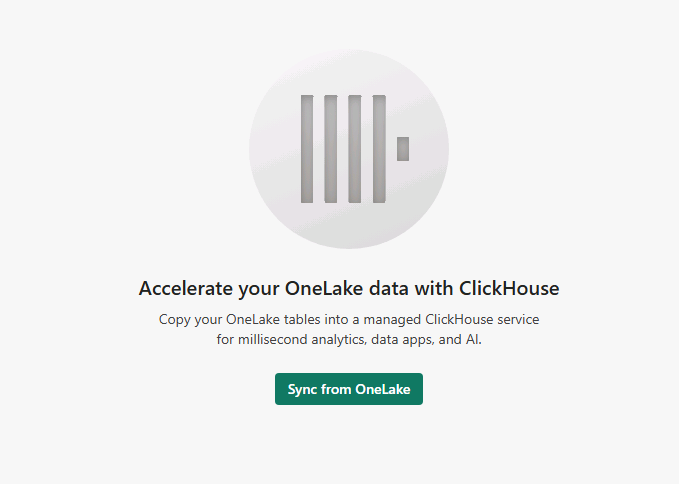
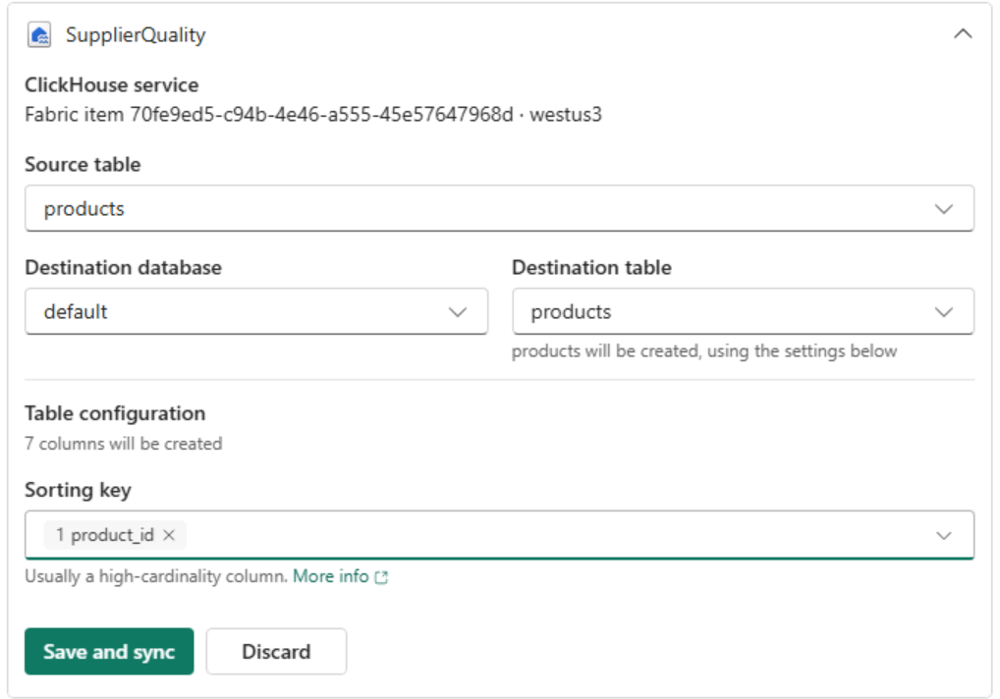
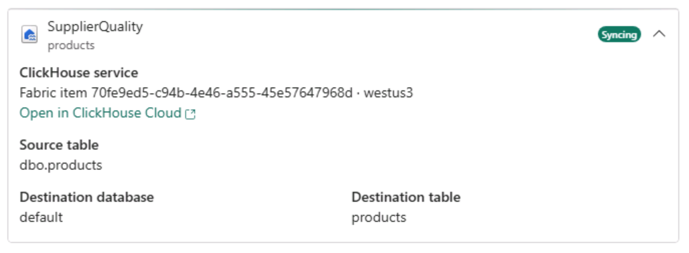
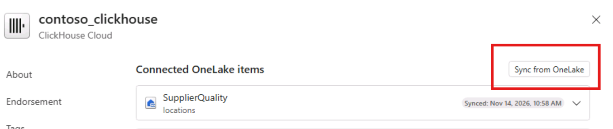
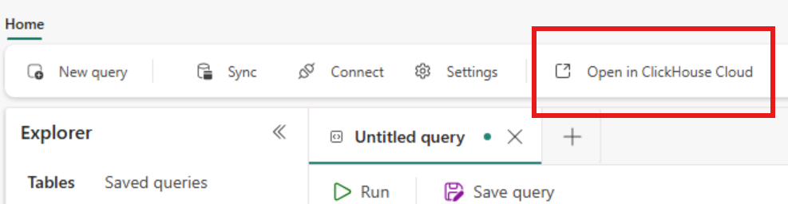

# Exercise 5.2: Discover and sync OneLake tables

The workload discovers tables in your lakehouse and uses managed ClickPipes to
load accelerated copies into ClickHouse. You do not need to export CSV files,
build a pipeline, or paste a storage token into SQL.

## Check your starting point

Open the ClickHouse item from Exercise 5.1. In the **SupplierQuality**
lakehouse, confirm that **Tables** contains the seven current-state tables
under **dbo** and **lot_history** and **shipment_history** under **history**.
Module 1's **dbo.supplier_certificates** may also be present.

## Task 1: Connect to the OneLake catalog

1. In the Fabric ClickHouse item, select **Sync** > **Sync from OneLake**.



2. In the lakehouse picker, find **SupplierQuality** in your lab workspace
   and select it. 
3. Select the first source table to map, **products**.

4. Choose Sort Key to be **product_id**



5. Click **Save and sync** and wait for the sync status to complete



6. Close the sync dialog box and return to ClickHouse main window.

## Task 2: Configure the accelerated copies

1. Open the embedded SQL console and run:

    ```sql
    SELECT * FROM default.products limit 100;
    ```

2. Return to **Sync from OneLake** and select only:

    - **dbo.locations**
    - **dbo.store_inventory**
    - **history.lot_history**
    - **history.shipment_history**

Select each table a time. To select more tables without exiting the window, click on **Sync from OneLake** botton in the top right corner. Note that source tables are listed without schema names (like dbo or history).



3. For each source use the default database, retaining the table's unqualified name: **locations**, **store_inventory**, **lot_history**, and **shipment_history**. Set it's primary key as the sort key for the destination table.

4. Select **Save and sync**. Watch the per-table status until all four tables
   finish. 

    > [!Note] Public-preview syncs are point-in-time snapshots, not continuous
    > replication. Later OneLake changes will not automatically appear in
    > these copies. Do not change the source data while the four syncs run:
    > separate table syncs are not evidence of one atomic cross-table snapshot.

## Task 3: Inspect sync status

1. Switch back to the browser tab with ClickHouse Console. If not open, click the **Open in ClickHouse Cloud** button



2. Select **Data sources** from the left navigation and verify all statuses are *Completed*

3. Select **Store_Inventory** (or any other table) and inspect the metrics. Notice the speed at which each table was synced and the total number of rows.

4. Swithc to the **Settings** tab, scroll down to inspect column mapping and data types. Note that ClickHouse follows strict typed column types for finer precision and storage optimizations.

## Task 4: Verify the copies

1. In the embedded SQL console, run:

    ```sql
    SHOW TABLES FROM default;
    DESCRIBE TABLE default.shipment_history;
    SELECT * FROM default.shipment_history LIMIT 10;
    ```
> [!Note] To execute a specific SQL statement, position the cursor on it and press Ctrl + Enter
2. Confirm that the four destination tables are present and shipment columns
   include **shipment_id**, **line_no**, **store_id**, **lot_id**, and **cases**.
   You will validate full counts and recall results in Exercise 5.3.
3. If you are resuming, inspect the existing sync statuses, destinations, and
   counts before doing anything else. Reuse completed copies that match the
   corrected source. Do not blindly append another snapshot to an existing
   table. For a failed or stale copy, ask the instructor to confirm the
   preview's supported retry or replacement procedure.


**Completion check:** Five completed syncs map the intended OneLake tables to
the five **Default** tables. The SQL console can read shipment rows, and you
recorded when the snapshot copies were loaded.
